# Evaluación 1 — Frontend responsivo y wireframes · Caso 22 «El Mediterráneo»

| | |
|---|---|
 Desarrollo Web y Móvil — Evaluación 1 
| **Caso de negocio** | **22. Comida mediterránea «El Mediterráneo»**  |
| **Integrantes** | Alejandro Narváez · Silenay Sarmiento |
| **Entregable** | Prototipo de frontend responsivo (PHP + Bootstrap 5 + JavaScript) con su diseño previo (wireframes en Figma y sistema de diseño) |
Este mismo frontend se convirtió a HTML. Esta evaluación es el **prototipo con datos fijos**, sin backend.


## Índice
1. [Objetivo y flujo](#1-objetivo-y-flujo-de-usuario) · 2. [Cómo ejecutarlo](#2-cómo-ejecutarlo) · 3. [Estructura](#3-estructura-del-proyecto) · 4. [Diseño previo](#4-diseño-previo-wireframes-y-sistema-de-diseño) · 5. [Pantallas](#5-pantallas-implementadas) · 6. [Responsividad](#6-diseño-responsivo) · 7. [JavaScript y servicios simulados](#7-javascript-estado-del-carrito-y-servicios-simulados) · 8. [Limitaciones](#8-limitaciones-conocidas)

---

## 1. Objetivo y flujo de usuario

**Actor:** cliente / comensal que visita el sitio web del restaurante.
**Objetivo:** explorar la carta, filtrar por categoría, elegir platos, gestionar el carrito, elegir cómo recibir el pedido y confirmarlo; además, reservar mesa y contactar al local.

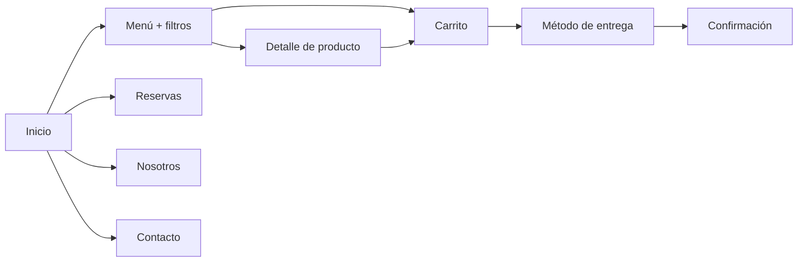

**Aspectos de frontend considerados (concerns):**
1. **Responsividad multi-dispositivo:** de móvil (390 px) a escritorio (1440 px) sin perder jerarquía visual.
2. **Estado en el cliente:** el carrito persiste en `localStorage` para no perder la selección al cambiar de página.
3. **Estados de interfaz:** carrito vacío, filtros activos, validación de formularios.
4. **Consistencia visual:** un sistema de diseño (colores, tipografías, componentes) reutilizado en todas las pantallas mediante `navbar.php` y `footer.php`.

---

## 2. Cómo ejecutarlo

Requiere **PHP** (los archivos son `.php`; usan `include` y arreglos de datos). Con XAMPP ya instalado, no hace falta configurar nada más.

**Opción A — servidor integrado de PHP** (desde esta carpeta):
```powershell
php -S localhost:8080
# abrir http://localhost:8080/index.php
```
**Opción B — XAMPP:** con Apache iniciado, abrir
`http://localhost/dwm2026/Proyecto-Desarrollo-Web-Movil/Evaluación%201/index.php`.

Las fuentes (Google Fonts), Bootstrap 5.3.8, Font Awesome 4.7 y las fotos de los platos (Pexels) se cargan desde Internet (CDN), por lo que se necesita conexión.

**Recorrido sugerido:** `index.php` → *Ver menú* → filtrar (p. ej. *Hummus*) → *Agregar* → ícono *Carrito* → ajustar cantidades con `+` / `−` → *Continuar a la entrega* → completar datos → *Confirmar pedido y pagar* → pantalla de confirmación.

---

## 3. Estructura del proyecto

| Archivo | Rol |
|---|---|
| `index.php` | Inicio: hero, especialidades, productos destacados y promoción |
| `menu.php` | Carta de 9 platos y filtros por categoría (`?categoria=hummus`) |
| `producto.php` | Detalle de un producto, ingredientes, selector de cantidad y sugerencias |
| `carrito.php` | Carrito: lista, cantidades, subtotal, envío y total (se dibuja con JavaScript) |
| `entrega.php` | Método de entrega (delivery / retiro, `?metodo=`) y formulario de datos |
| `confirmacion.php` | Pantalla de pedido confirmado |
| `reservas.php` | Formulario de reserva de mesa |
| `nosotros.php` · `contacto.php` | Historia y pilares · ubicación, datos y formulario de contacto |
| `navbar.php` · `footer.php` | Componentes reutilizados con `include` en todas las páginas |
| `carrito.js` | Gestor del carrito en `localStorage` (`CarritoStorage`) |
| `main.js` | Interacciones básicas (menú móvil y *steppers*); **ver limitaciones** |
| `style.css` | Variables del sistema de diseño y estilos propios sobre Bootstrap |
| `EL-MEDITERRANEO-Bosquejo-y-Paleta-de-colores.md` | Documentación de wireframes, paleta y pantallas |
| `img/` | Wireframes de las 9 pantallas (Figma) |
| `capturas/` | Capturas del prototipo implementado (escritorio, tablet y móvil) |

---

## 4. Diseño previo: wireframes y sistema de diseño

El diseño se planificó antes de programar con **wireframes en escala de grises (Figma)** de las 9 pantallas, detallados en [`EL-MEDITERRANEO-Bosquejo-y-Paleta-de-colores.md`](EL-MEDITERRANEO-Bosquejo-y-Paleta-de-colores.md).

| Inicio | Menú | Producto |
|---|---|---|
|  |  |  |

| Carrito | Entrega | Reservas |
|---|---|---|
|  |  |  |

| Nosotros | Contacto | Confirmación |
|---|---|---|
|  |  |  |

### Sistema de diseño (implementado en `style.css`, variables `:root`)

| Token | HEX | Uso |
|---|---|---|
| Carbón `--carbon` | `#1A1A1A` | Navbar, footer, texto |
| Tierra `--tierra` | `#3B2A20` | Fondos secundarios, títulos de sección |
| Fuego `--fuego` | `#A63B1E` | Botón principal (CTA) y precios |
| Llama `--llama` | `#E07A1F` | Acentos y *hover* |
| Sol `--sol` | `#F2C94C` | Logo y detalles |
| Arena `--arena` | `#DCC7A1` | Bordes de campos y filtros |
| Oliva `--oliva` | `#5E6B3D` | Categorías e iconos |
| Crema `--crema` | `#F3EFE6` | Fondo principal |

**Tipografías:** *Cinzel* (títulos), *Montserrat* (texto), *Playfair Display* (detalles decorativos). **Componentes reutilizables:** navbar fija con contador de carrito, footer de 3 columnas (marca, horarios, contacto), tarjeta de producto, botones primario y secundario, campos de formulario y *pills* de filtro.

---

## 5. Pantallas implementadas

Capturas del prototipo en ejecución (`capturas/`).

| Pantalla | Archivo | Qué hace |
|---|---|---|
| Inicio | `index.php` | Hero con *Ver menú* y *Reservar*, 4 especialidades, 3 productos destacados con *Agregar*, promoción |
| Menú | `menu.php` | 9 platos; filtros por categoría resueltos en el servidor con `$_GET['categoria']` |
| Producto | `producto.php` | Ficha con ingredientes, selector de cantidad y *Agregar al carrito* |
| Carrito | `carrito.php` | Líneas con `+` / `−` / eliminar, subtotal, envío ($2.500) y total; estado vacío |
| Entrega | `entrega.php` | Tarjetas *Delivery* / *Retiro en local* y formulario de despacho |
| Confirmación | `confirmacion.php` | Mensaje de éxito y resumen de la compra |
| Reservas | `reservas.php` | Formulario: fecha, hora, personas, nombre, teléfono, correo |
| Nosotros | `nosotros.php` | Historia y tres pilares |
| Contacto | `contacto.php` | Ubicación, datos del local y formulario de mensaje |

| Inicio (escritorio) | Menú (escritorio) |
|---|---|
| 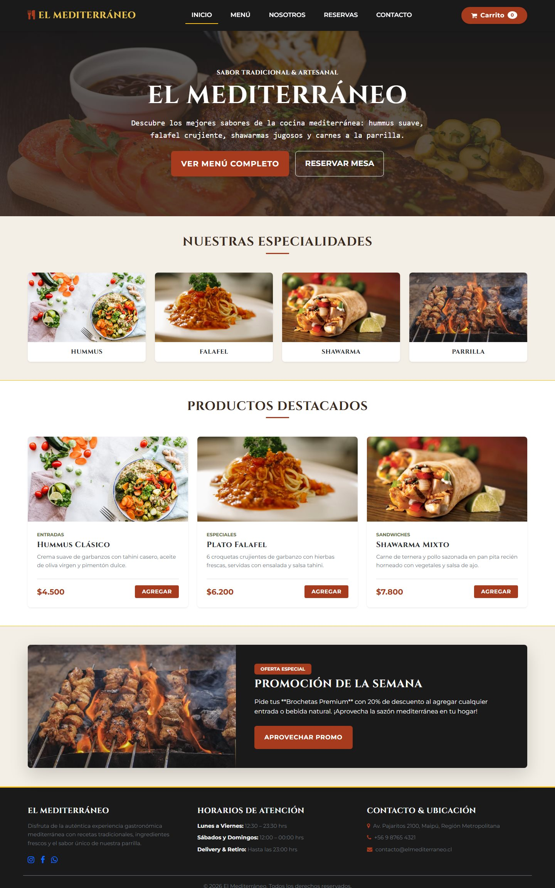 | 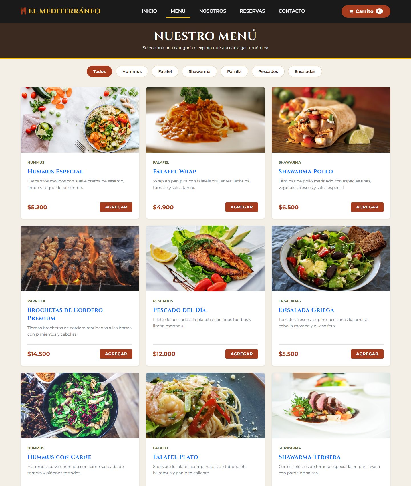 |

| Producto | Filtro «Hummus» |
|---|---|
| 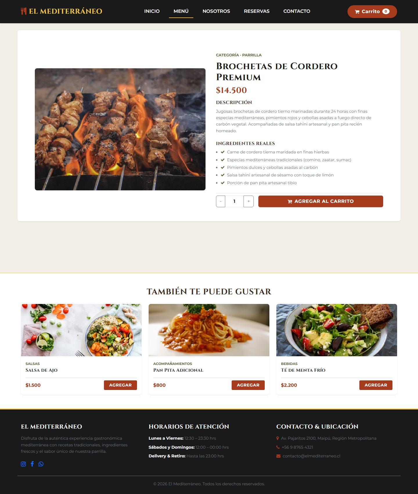 | 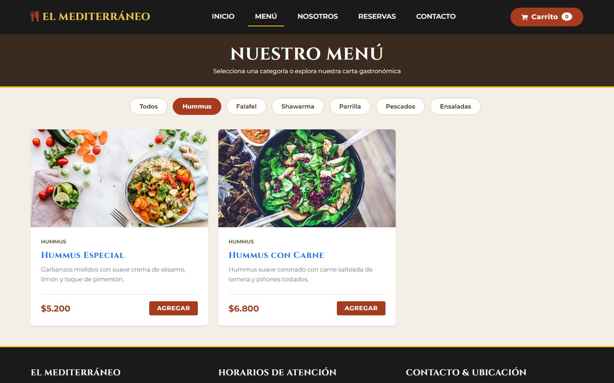 |

| Carrito con productos | Entrega |
|---|---|
| 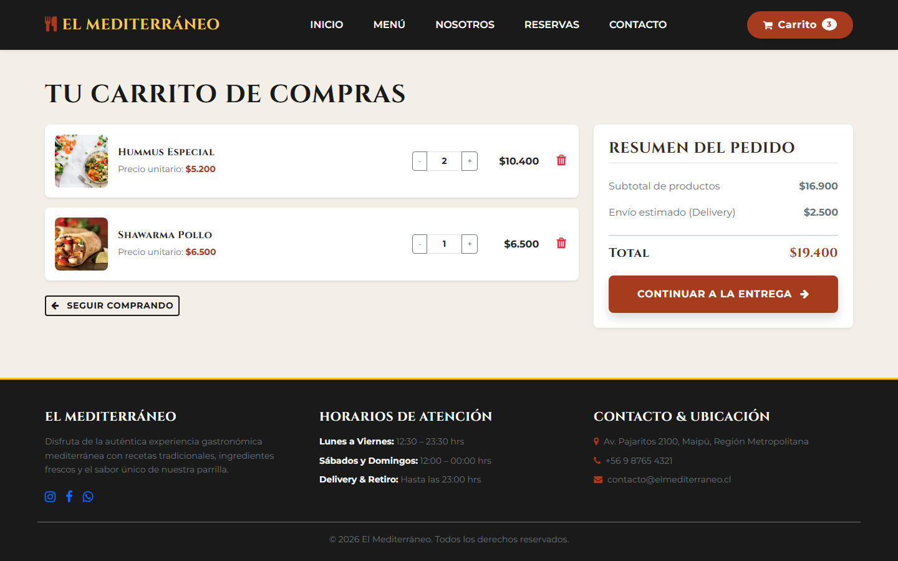 | 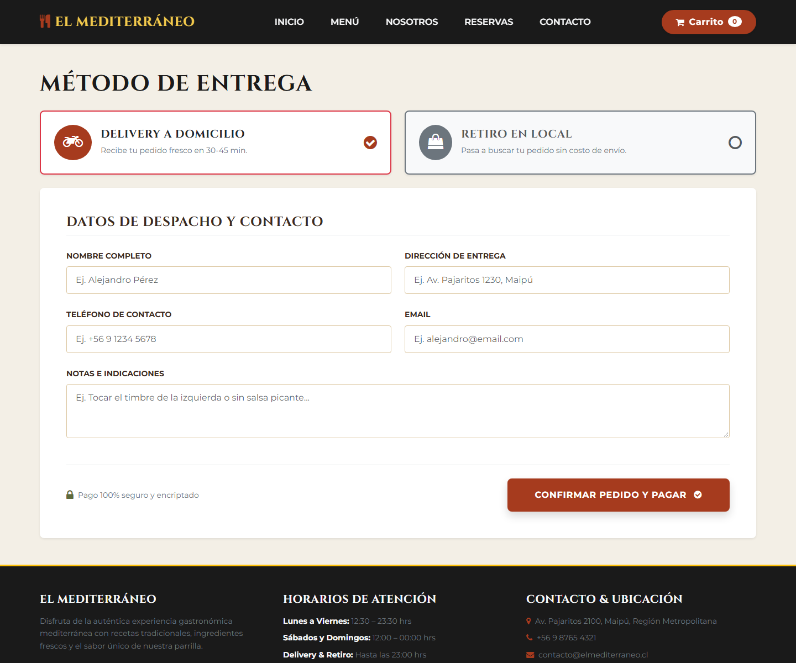 |

| Reservas | Confirmación |
|---|---|
| 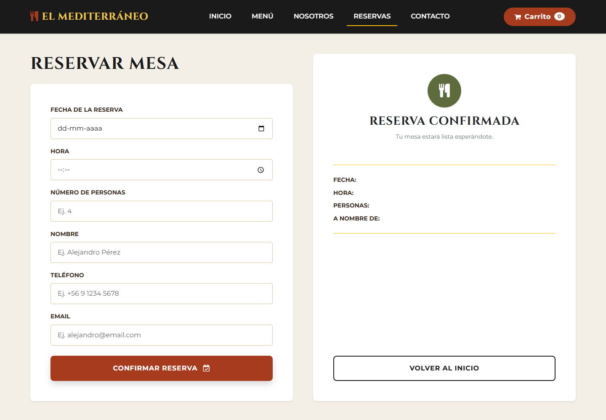 | 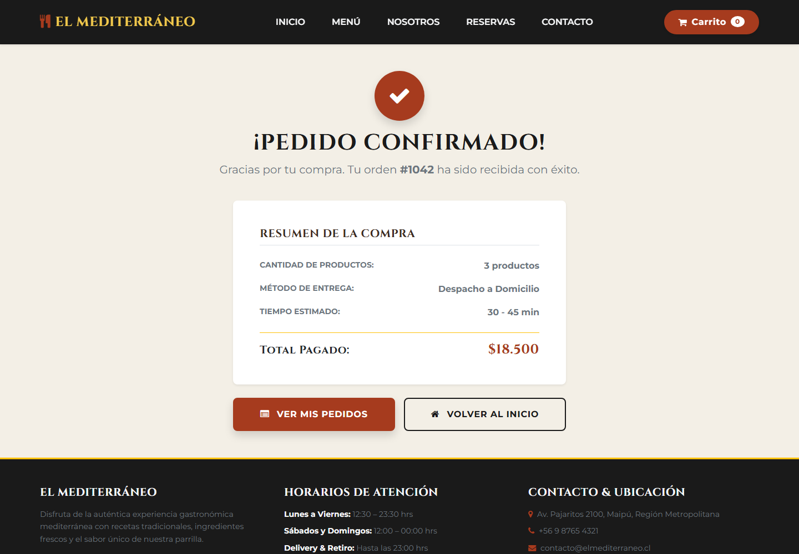 |

| Nosotros | Contacto |
|---|---|
| 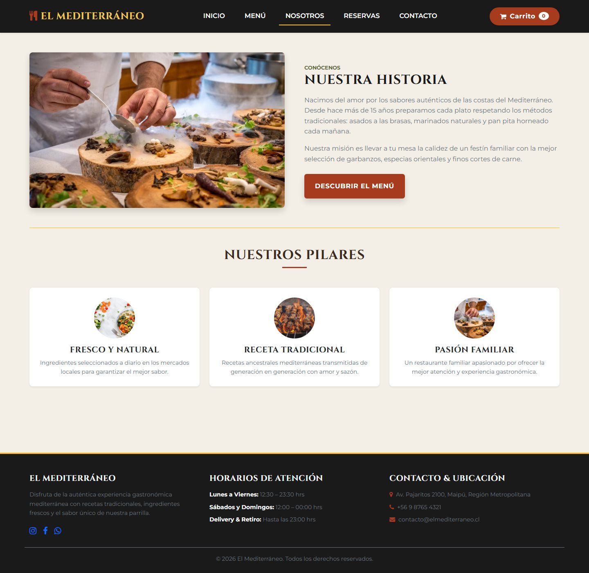 | 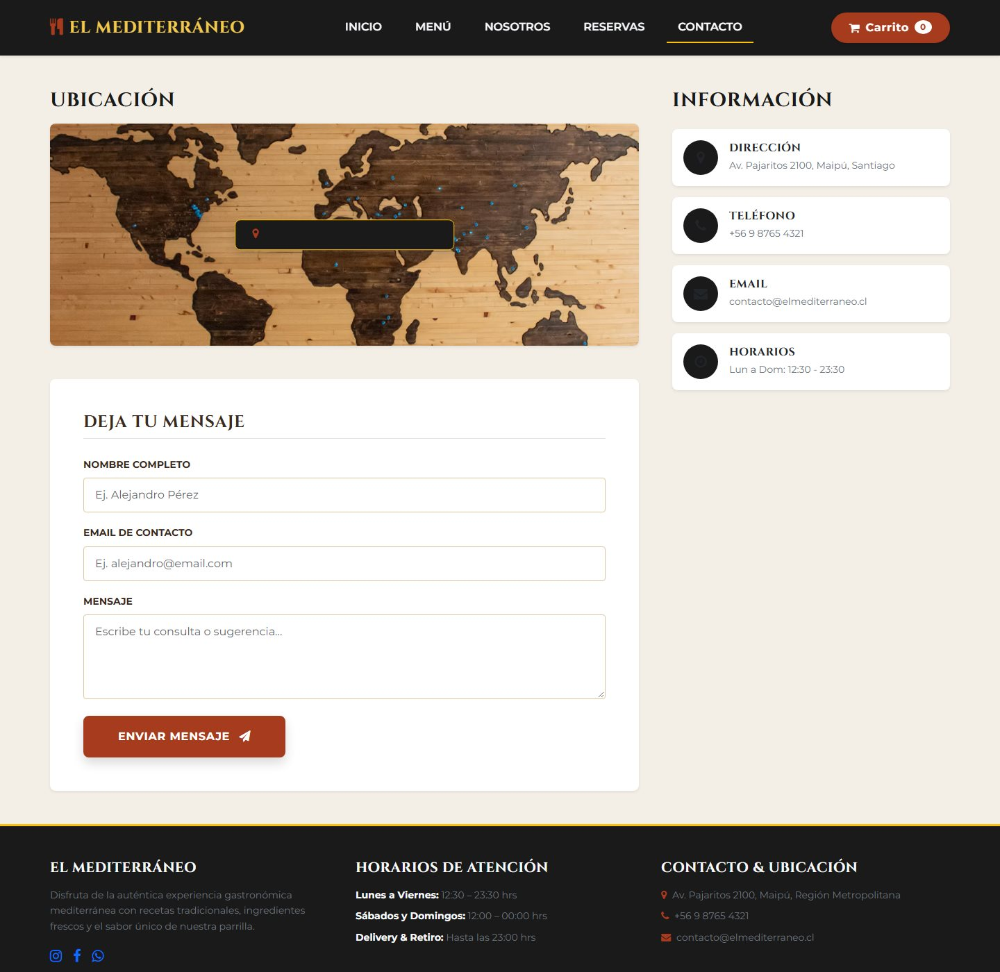 |

---

## 6. Diseño responsivo

Se usa la **grilla de 12 columnas de Bootstrap 5.3.8** (`container`, `row`, `col-*`). La proporción de una columna es `columnas = 12 × (ancho del elemento / ancho del contenedor)`.

**Puntos de quiebre de Bootstrap usados:** `md` ≥ 768 px y `lg` ≥ 992 px. La navegación usa `navbar-expand-lg`: por debajo de 992 px se contrae en el botón hamburguesa.

| Ancho evaluado | Clases clave | Resultado observado |
|---|---|---|
| **Móvil 390 px** | `col-12` | Tarjetas del menú en **1 columna**; navbar con hamburguesa; en el carrito cada línea ocupa el ancho completo y el **resumen pasa debajo** |
| **Tablet 768 px** | `col-md-6` | Menú en **2 columnas**; formularios en 2 columnas (`col-md-6`) |
| **Escritorio 1440 px** | `col-lg-4`, `col-lg-8` / `col-lg-4` | Menú en **3 columnas**; carrito con lista en 8/12 (≈ 67 %) y resumen en 4/12 (≈ 33 %) |

Evidencia (mismo menú en tres anchos):

| Móvil 390 px | Tablet 768 px | Escritorio 1440 px |
|---|---|---|
| 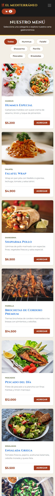 | 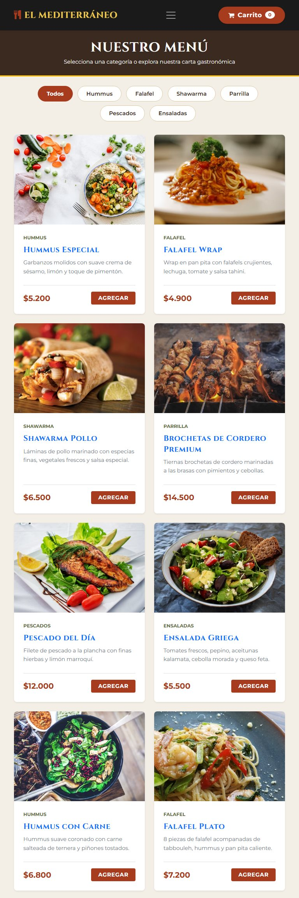 |  |

| Inicio (móvil) | Carrito vacío (móvil) | Carrito con productos (móvil) | Entrega (móvil) |
|---|---|---|---|
| 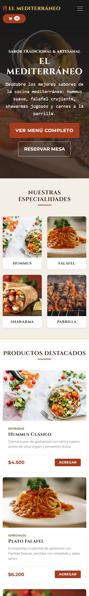 | 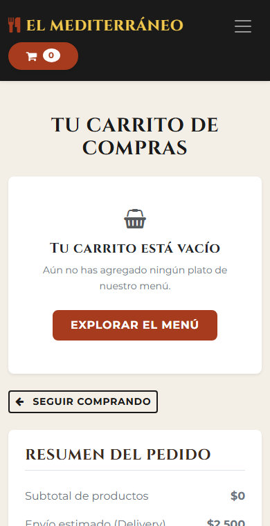 | 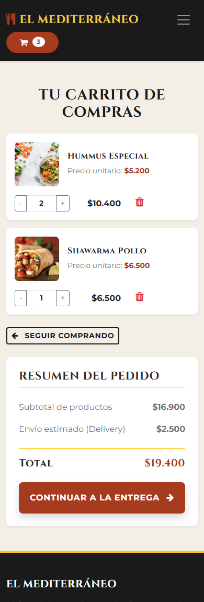 | 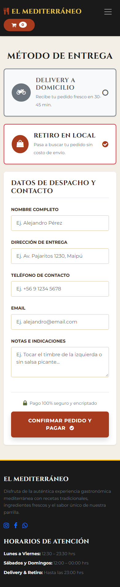 |

**Box model:** Bootstrap aplica `box-sizing: border-box` a todos los elementos; el espaciado se controla con utilidades (`p-3`, `p-4`, `mb-3`, `gap-3`).

**Flexbox:** las tarjetas del menú usan `d-flex flex-column h-100` con el pie `mt-auto`, de modo que precio y botón *Agregar* quedan alineados en la base aunque las descripciones tengan largos distintos. Las líneas del carrito usan `d-flex align-items-center flex-wrap gap-3`, por lo que cantidad y precio fluyen a otra fila cuando el ancho se estrecha (visible en la captura móvil).

---

## 7. JavaScript, estado del carrito y servicios simulados

### Carrito en el cliente (`carrito.js`)
Objeto `CarritoStorage` que guarda un arreglo en `localStorage` bajo la clave `el_mediterraneo_carrito`, con elementos `{nombre, precio, cantidad, img}`:

| Método | Efecto |
|---|---|
| `obtener()` / `guardar(items)` | Lee y escribe el carrito (con `try/catch` por si el almacenamiento no está disponible) |
| `agregar(producto)` | Suma la cantidad si el plato ya existe, si no lo agrega |
| `modificarCantidad(i, delta)` | Cambia la cantidad; si llega a 0, elimina la línea |
| `eliminar(i)` | Quita la línea |
| `totalCount()` / `actualizarBadge()` | Actualiza el contador del navbar en cada página |

### Manipulación del DOM
`carrito.php` dibuja el carrito con `renderCarrito()`: toma los datos de `CarritoStorage`, construye el HTML de cada línea con plantillas de texto, lo inserta en `#contenedor-items` y recalcula subtotal y total (`subtotal + envío`) **sin recargar la página**. Si no hay productos muestra el **estado vacío** («Tu carrito está vacío», botón *Explorar el menú*) y deshabilita *Continuar a la entrega*. Los botones `+`, `−` y eliminar usan manejadores `onclick` que actualizan el almacenamiento y vuelven a dibujar.

### Qué es simulado («servicios dummy»)

| Función | Cómo se simula |
|---|---|
| Consultar la carta | Los 9 platos son un **arreglo PHP** dentro de `menu.php`; el filtro por categoría se aplica en el servidor sobre ese arreglo |
| Total del pedido | Se calcula **en el navegador** (subtotal + envío fijo de $2.500) |
| Confirmar pedido | `entrega.php` envía el formulario por `POST` a `confirmacion.php`, que **muestra un resumen fijo** (pedido #1042, 3 productos, $18.500, «Despacho a Domicilio») |
| Reservar / contactar | Los formularios envían a su propia página; **no se guarda ni se procesa nada** |

### Estados de interfaz contemplados
| Estado | Dónde |
|---|---|
| Vacío | Carrito sin productos (capturas móvil y escritorio) |
| Activo/seleccionado | Filtro de categoría y tarjeta de método de entrega (*Delivery* / *Retiro*) |
| Validación | Atributos HTML5 `required`, `type="email"`, `type="tel"`, `type="date"`, `type="time"`, `min="1"` en los formularios |
| Retroalimentación | `alert('¡Producto agregado al carrito!')` al agregar, y contador del navbar |

---

## 8. Limitaciones conocidas

Se declaran para no afirmar más de lo implementado:

| # | Limitación | Estado |
|---|---|---|
| 1 | **No hay backend ni base de datos**: carta, precios y confirmación son datos fijos en el código. | Resuelto en la Evaluación 2 (microservicios + SQLite). |
| 2 | **`confirmacion.php` es estática** (siempre #1042, 3 productos, $18.500); no refleja el carrito real. | Resuelto en la Evaluación 2 (el número y el total vienen del servidor). |
| 3 | **Los precios y el total viven en el navegador** (`localStorage`) y el cliente los puede alterar. | Resuelto en la Evaluación 2: el navegador solo guarda `{id, cantidad}` y el servidor calcula los precios. |
| 4 | **`producto.php` tiene un único producto fijo** (Brochetas de Cordero); todos los enlaces del menú llevan a esa ficha. | Pendiente en esta versión. |
| 5 | **Reservas y contacto** no guardan ni confirman nada. | Resuelto en la Evaluación 2 (reservas y mensajes se persisten). |
| 6 | **La dirección es obligatoria también en «Retiro en local»**: el formulario es el mismo para ambos métodos. | Corregido en la Evaluación 2 (en retiro se oculta). |
| 7 | **No hay sesión ni cuentas**: «Ver mis pedidos» lleva al carrito, según la decisión de flujo del bosquejo. | Resuelto en la Evaluación 2 (registro, sesión y pedidos). |
| 8 | **`main.js` no está enlazado en ninguna página**: el menú hamburguesa funciona con el JavaScript de Bootstrap. | Archivo sin uso. |
| 9 | No hay indicador de «cargando» ni pruebas automatizadas. | Pendiente. |
| 10 | El carrito se dibuja con `innerHTML` a partir de datos de `localStorage`, sin escapar. | Corregido en la Evaluación 2 (el contenido dinámico se escapa con `esc()` antes de insertarlo). |
| 11 | Las fotos y fuentes dependen de CDN externos (se necesita Internet). | Aceptado para el prototipo. |
| 12 | El bosquejo del Figma usa datos de contacto de ejemplo (Barcelona); el sitio implementado usa los datos del local en Maipú. | Informativo. |

