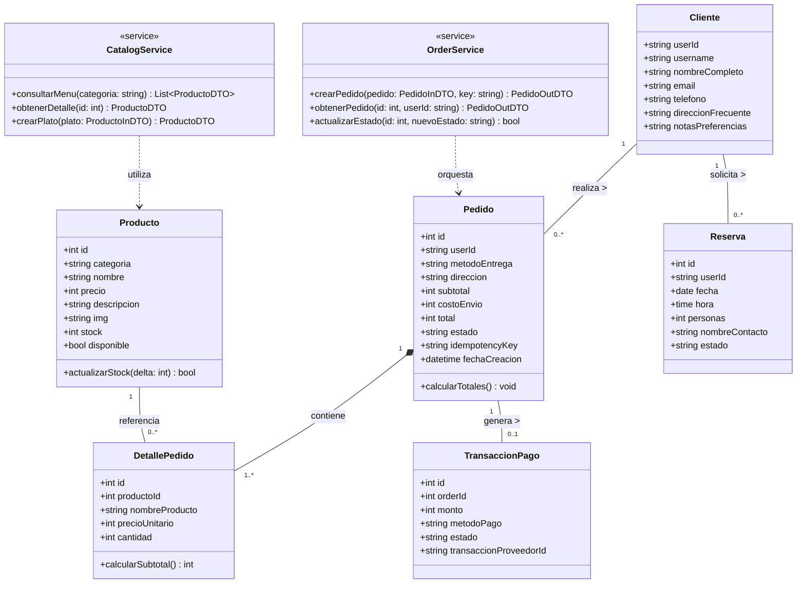
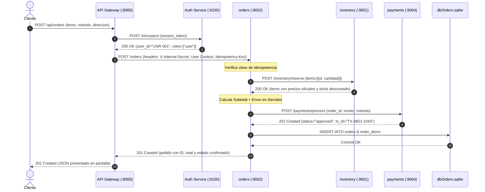
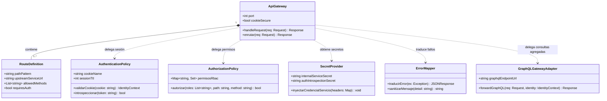

# INFORME DE ARQUITECTURA Y EVALUACIÓN DE LA UNIDAD 2
## Diseño e Implementación de un Backend Seguro Completo

---

### Portada y Datos Generales del Proyecto

* **Institución:** Universidad / Asignatura de Desarrollo Web y Móvil
* **Evaluación:** Evaluación de la Unidad 2 — Backend Seguro Completo
* **Fecha de Entrega:** 09 de noviembre de 2026
* **Caso de Negocio Asignado:** **Caso 22: Comida Mediterránea “El Mediterráneo”** (especialidades: hummus, falafel, shawarma, carnes a la brasa, pescados, ensaladas)
* **Integrantes del Equipo:**
  1. **Alejandro Narváez**
  2. **Silenay Sarmiento**
* **Versión del Frontend Integrado:** v2.4 (Frontend responsivo multi-pantalla convertido a HTML semántico compatible con CSP estricto, conectado al API Gateway y agregación GraphQL).

#### Declaración de Requisitos y Gestión de Brechas del Frontend
| ID Requisito | Descripción del Requisito de Negocio | Pantallas Existentes en Frontend | Estado de la Brecha / Resolución |
|---|---|---|---|
| **REQ-01** | Visualización de catálogo público y filtros por categoría | P01 (Inicio), P02 (Menú), P03 (Detalle Producto) | **Resuelto:** Catálogo servido desde microservicio `inventory` vía `/public/menu`. |
| **REQ-02** | Gestión de carrito de compra en el navegador | P04 (Carrito) | **Resuelto:** Almacenamiento local de IDs y cantidades; precios sincronizados en servidor. |
| **REQ-03** | Registro y procesamiento de pedidos (Delivery / Retiro) | P05 (Entrega - Delivery), P05b (Entrega - Retiro) | **Resuelto:** Microservicio `orders` calcula totales reales, reserva stock en `inventory` y procesa cobro en `payments`. |
| **REQ-04** | Confirmación y tracking de órdenes generadas | P09 (Confirmación) | **Resuelto:** Muestra resumen oficial de orden y consulta agregada GraphQL (`resumenPedido`). |
| **REQ-05** | Reserva de mesas en salón | P06 (Reservas) | **Resuelto:** Endpoint transaccional protegido en `orders` con persistencia en `dbOrders.sqlite`. |
| **REQ-06** | Autenticación y gestión de sesiones seguras | Panel Modal / P01 (Login) | **Resuelto:** `auth_service` emite cookies HttpOnly con hashing `scrypt` y sesiones opacas. |
| **REQ-07** | Administración de carta e inventario | Panel `/panel#/admin` | **Resuelto:** Operaciones protegidas por rol `admin` para altas y bajas de productos. |
| **REQ-08** | Mensajería de contacto y atención a clientes | P08 (Contacto) | **Brecha Declarada:** Formulario informativo con registro de auditoría en Gateway. |

---

## Módulo 1: Servicios Derivados del Frontend

### Propósito
Identificar cada operación requerida por la interfaz, delimitando estrictamente la frontera navegador-backend y aplicando el principio de **confianza cero**: *el cliente jamás envía precios, totales ni confirma estados de pago; el backend es la única autoridad de cálculo.*

### Matriz de Servicios y Trazabilidad de Pantallas
| ID Servicio | Requisito | Pantalla y Acción | Propósito del Servicio | Verbo y Ruta | Entrada (Payload/Parámetros) | Salida (Códigos y Respuesta) | Reglas de Negocio y Errores | Clasificación Datos | Acceso |
|---|---|---|---|---|---|---|---|---|---|
| **S01** | REQ-01 | P01/P02: Carga de carta | Consultar catálogo de platos disponibles | `GET /public/menu` | Query: `categoria` (opcional) | `200 OK`: `[{id, categoria, nombre, precio, descripcion, img, stock}]` | Valida categorías admitidas. Filtra platos no disponibles. | Público | Anónimo |
| **S02** | REQ-06 | Modal Login: Autenticarse | Iniciar sesión de usuario/operador | `POST /auth/login` | Body: `{username, password}` | `200 OK`: Cookie HttpOnly `session_token`, `{status, username, roles}` | `401 Unauthorized` ante error. Hashing `scrypt` con tiempo constante. | Credencial / Restringido | Anónimo |
| **S03** | REQ-06 | Navbar: Comprobar sesión | Consultar perfil autenticado actual | `GET /auth/me` | Cookie: `session_token` | `200 OK`: `{user_id, username, roles}` | `401 Unauthorized` si la sesión no existe o expiró. | Restringido | Autenticado |
| **S04** | REQ-06 | Navbar: Salir | Invalidar y revocar sesión | `POST /auth/logout` | Cookie: `session_token` | `200 OK`: `{status: "logged_out"}`, borra cookie | Revoca sesión en `dbIdentity` e invalida la cookie. | Restringido | Autenticado |
| **S05** | REQ-03 | P05: Confirmar pedido | Crear pedido con cálculo oficial | `POST /api/orders` | Body: `{items:[{id, cantidad}], metodo, nombre, telefono, direccion, notas}`, Header: `X-Idempotency-Key` | `201 Created`: `{id, total, subtotal, envio, status, items}` | Delivery exige dirección. Precios ignorados del cliente. `409 Conflict` si no hay stock. | Personal / Restringido | Autenticado |
| **S06** | REQ-03 | Panel: Mis pedidos | Listar pedidos del cliente | `GET /api/orders` | Cookie `session_token` | `200 OK`: `{orders: [...]}` | Control de propiedad: clientes ven solo sus pedidos; admin ve todos. | Personal | Autenticado |
| **S07** | REQ-04 | P09: Detalle pedido | Consultar detalle de un pedido | `GET /api/orders/{id}` | Path: `id` | `200 OK`: `{id, items, total, status}` | `403 Forbidden` si el pedido pertenece a otro usuario (DSL D_F03_Ajeno). | Personal | Autenticado |
| **S08** | REQ-05 | P06: Reservar mesa | Registrar reserva en salón | `POST /api/reservations` | Body: `{fecha, hora, personas, nombre, telefono}` | `201 Created`: `{id, fecha, hora, personas, status}` | Valida formato de fecha/hora y capacidad máxima (1 a 20 personas). | Personal | Autenticado |
| **S09** | REQ-07 | Panel Admin: Alta plato | Agregar nuevo producto al menú | `POST /api/products` | Body: `{categoria, nombre, precio, descripcion, img, stock}` | `201 Created`: `{id, nombre, precio}` | Exige rol `admin`. Valida precio > 0 y categorías oficiales. | Público / Interno | Admin |
| **S10** | REQ-07 | Panel Admin: Baja plato | Desactivar plato de la carta | `DELETE /api/products/{id}` | Path: `id` | `200 OK`: `{deleted: id, status: "marcado_no_disponible"}` | Exige rol `admin`. Eliminación lógica sin romper órdenes históricas. | Interno | Admin |
| **S11** | REQ-04 | P09: Agregación GraphQL | Resumen enriquecido de pedido | `POST /graphql` | Body: Query `resumenPedido(orderId: $id)` | `200 OK`: `{data: {resumenPedido: {...}}}` | Límite de profundidad $\le 6$. Agrega pedidos, catálogo y perfil de cliente. | Mixto | Autenticado |

### Ejemplos de Contratos JSON

#### Contrato S05: Creación de Pedido (`POST /api/orders`)
**Solicitud enviada desde el navegador:**
```json
{
  "items": [
    { "id": 1, "cantidad": 2 },
    { "id": 4, "cantidad": 1 }
  ],
  "metodo": "delivery",
  "nombre": "Ana García",
  "telefono": "+56912345678",
  "direccion": "Av. Pajaritos 2100, Depto 402, Maipú",
  "notas": "Tocar timbre del departamento"
}
```
*Cabeceras enviadas:* `Cookie: session_token=...`, `X-Idempotency-Key: a4f8b2c1-7d9e`

**Respuesta oficial generada por el servidor (`201 Created`):**
```json
{
  "id": 1043,
  "user_id": "USR-001",
  "username": "ana",
  "items": [
    { "id": 1, "nombre": "Hummus Especial", "precio": 5200, "cantidad": 2 },
    { "id": 4, "nombre": "Brochetas de Cordero Premium", "precio": 14500, "cantidad": 1 }
  ],
  "metodo": "delivery",
  "nombre": "Ana García",
  "telefono": "+56912345678",
  "direccion": "Av. Pajaritos 2100, Depto 402, Maipú",
  "notas": "Tocar timbre del departamento",
  "subtotal": 24900,
  "envio": 2500,
  "total": 27400,
  "status": "confirmed"
}
```

---

## Módulo 2: Clases y Cardinalidades del Dominio

### Diagrama UML de Clases del Dominio y Servicios Públicos



### Tabla de Relaciones, Multiplicidades y Justificación de Negocio
| Clase Origen | Clase Destino | Multiplicidad | Tipo Relación | Regla y Justificación de Negocio |
|---|---|---|---|---|
| **Cliente** | **Pedido** | `1` a `0..*` | Asociación | Un cliente registrado puede no haber comprado aún (`0`) o acumular múltiples compras a lo largo del tiempo (`*`). Cada pedido está asociado inequívocamente a un titular (`1`). |
| **Pedido** | **DetallePedido** | `1` a `1..*` | Composición | Todo pedido confirmado exige al menos un producto (`1..*`). Si el pedido se elimina o anula, sus líneas de detalle no tienen existencia autónoma (`Composición`). |
| **Producto** | **DetallePedido** | `1` a `0..*` | Asociación | Un producto del catálogo puede no haberse ordenado aún (`0`) o figurar en múltiples pedidos (`*`). El detalle congela el precio histórico al momento de la compra. |
| **Pedido** | **TransaccionPago** | `1` a `0..1` | Asociación | Un pedido inicia sin pago o pendiente (`0`) y se asocia a un único comprobante de pago aprobado (`1`). El sistema impide duplicar cobros para la misma orden. |
| **Cliente** | **Reserva** | `1` a `0..*` | Asociación | Un cliente puede reservar mesa en varias fechas; cada reserva pertenece a un único titular. |

### Separación entre Modelo Interno y DTOs
* **Modelo Interno (Entidades de Dominio / BD):** Almacenan atributos sensibles de negocio como `stock`, costo de preparación, llaves foráneas y registros de auditoría que no deben divulgarse a clientes.
* **DTOs de Entrada (ej. `PedidoIn`):** Solo admiten `{id, cantidad, metodo, datos_despacho}`. No contienen campos de precio o total, impidiendo que el cliente adultere los valores.
* **DTOs de Salida (ej. `PedidoOut`, `ProductoDTO`):** Filtran contraseñas, secretos técnicos y datos de terceros.

---

## Módulo 3: Sistemas e Integraciones

### Propósito y Separación de Responsabilidades
La plataforma implementa la arquitectura de microservicios modelada en Structurizr DSL (`PlataformaComercial_Despliegue.dsl`), distribuyendo responsabilidades para evitar que un subsistema monopolice el control de datos ajenos:

1. **`inventory` (Puerto 9001):** Autoridad absoluta sobre catálogo, precios oficiales y disponibilidad de stock.
2. **`orders` (Puerto 9002):** Máquina de estados del ciclo de vida de pedidos, reservas y control de idempotencia.
3. **`clients` (Puerto 9003):** Autoridad sobre perfiles, teléfonos, direcciones frecuentes y privacidad del cliente.
4. **`payments` (Puerto 9004):** Coordinación de cobros, verificación de transacciones y prevención de doble cargo.

### Matriz de Integración de Sistemas
| Sistema | Responsabilidad | Datos que Administra | Servicios Asociados | Dependencias | Contrato de Integración | Credencial Requerida | Tratamiento ante Fallos |
|---|---|---|---|---|---|---|---|
| **inventory** | Catálogo y control de existencias | `products` (precio, descripción, stock, disponible) | S01, S09, S10 | Ninguna | REST HTTP/JSON (`/inventory/reserve`) | `X-Internal-Secret` | Operación atómica en BD; rollback ante stock insuficiente. |
| **orders** | Orquestación de pedidos y reservas | `orders`, `order_items`, `reservations`, `idempotency` | S05, S06, S07, S08 | `inventory`, `payments` | REST HTTP/JSON (`POST /orders`) | `X-Internal-Secret`, Contexto de Identidad | Si `inventory` falla, aborta pedido (503). Si `payments` degrada, pedido queda en `pending`. |
| **clients** | Custodia de perfiles y datos personales | `clients` (RUN/ID, nombres, teléfono, dirección) | Perfil cliente | Ninguna | REST HTTP/JSON (`GET /clients/me`) | `X-Internal-Secret`, `X-Authenticated-User` | Retorna 404 si el perfil no existe; no revela información ajena. |
| **payments** | Cobro y validación de transacciones | `payments` (order_id, monto, tx_id, estado) | Procesamiento pago | Proveedor Pasarela | REST HTTP/JSON (`/payments/process`) | `X-Internal-Secret` | Respuesta idempotente ante reintentos; no procesa doble cobro. |

### Secuencia de Integración: Registro de Pedido Exitoso (DSL D_F02_Exito)



---

## Módulo 4: Stakeholders y Permisos HTTP

### Registro de Partes Interesadas (Stakeholders)
1. **Visitante (Anónimo):** Persona que navega el menú y consulta precios sin registrarse. Solo lectura pública.
2. **Cliente Autenticado (Rol `user`):** Usuario registrado que gestiona su carrito, realiza pedidos, reserva mesas y consulta su propio historial.
3. **Operador / Administrador (Rol `admin`):** Personal de cocina y operaciones que actualiza catálogo, cambia estados de órdenes y gestiona disponibilidad.
4. **Auditor / Supervisor:** Parte interesada que revisa métricas y cumplimiento. **Sin permisos operativos directos**: recibe reportes consolidados sin credenciales de base de datos.
5. **Pasarela de Pago (Sistema Externo):** Proveedor de cobros que confirma transacciones mediante webhooks autenticados.

### Matriz de Permisos por Ruta, Verbo y Condición
| Rol / Identidad | ID Servicio | Ruta HTTP | Verbo | Decisión | Alcance y Condición | Lugar de Verificación |
|---|---|---|---|---|---|---|
| **Visitante** | S01 | `/public/menu` | `GET` | **Permitido** | Acceso a campos públicos del catálogo (sin costos ni márgenes). | API Gateway |
| **Visitante** | S05 | `/api/orders` | `POST` | **Denegado (401)** | Requiere iniciar sesión previamente. | API Gateway |
| **Cliente (`user`)** | S05 | `/api/orders` | `POST` | **Permitido** | Válido con sesión activa; calcula precios en servidor. | Gateway y Orders |
| **Cliente (`user`)** | S06 | `/api/orders` | `GET` | **Permitido (Filtrado)** | Solo visualiza órdenes donde `user_id == caller.user_id`. | Orders Service |
| **Cliente (`user`)** | S07 | `/api/orders/{id}` | `GET` | **Condicionado** | `403 Forbidden` si `order.user_id != caller.user_id`. | Orders Service |
| **Cliente (`user`)** | S09 | `/api/products` | `POST` | **Denegado (403)** | Consultar el menú no otorga facultades administrativas. | API Gateway |
| **Admin (`admin`)** | S09 | `/api/products` | `POST` | **Permitido** | Autorizado para incorporar nuevos platos al catálogo. | Gateway y Inventory |
| **Admin (`admin`)** | S10 | `/api/products/{id}` | `DELETE` | **Permitido** | Baja lógica de plato; no borra historial transaccional. | Gateway y Inventory |
| **Admin (`admin`)** | S06 | `/api/orders` | `GET` | **Permitido Total** | Supervisión de todas las órdenes de la plataforma. | Orders Service |
| **Auditor** | — | `/api/*` | Cualquiera | **Sin permisos operativos** | Recibe reportes analíticos generados asíncronamente. | Política de Seguridad |

---

## Módulo 5: Clases del API Gateway

### Propósito y Decisiones de Diseño
El API Gateway actúa como **Reverse Proxy y Policy Enforcement Point (PEP)**. Se diseñó **un único API Gateway centralizado** para evitar fragmentación de reglas y garantizar que el navegador nunca interactúe directamente con la red interna de microservicios ni conozca puertos privados.

### Diagrama UML de Clases del API Gateway y Políticas



### Fronteras de Confianza y Recorrido de Solicitudes
* **Zona Desconfiada (Internet / Navegador):** Comunicación vía HTTPS. El Gateway descarta automáticamente cabeceras como `X-Authenticated-User`, `X-Internal-Secret` o cookies manipuladas.
* **Zona de Confianza Interna:** Los microservicios solo escuchan en la red privada y exigen la cabecera `X-Internal-Secret: gateway-api-secret-456`.
* **Recorrido Solicitud Autorizada:**
  1. El cliente envía `POST /api/orders` con la cookie `session_token`.
  2. El Gateway extrae la cookie, llama a `auth_service:8100/introspect` y valida la vigencia.
  3. Verifica la matriz RBAC para el rol `user`.
  4. Inyecta `X-Internal-Secret`, `X-Authenticated-User` y despacha a `orders:9002`.
* **Recorrido Solicitud Denegada:**
  1. Un cliente con rol `user` envía `POST /api/products` (intento de crear plato).
  2. El Gateway comprueba RBAC: `POST` en `/products` solo está asignado al rol `admin`.
  3. El Gateway corta la petición de inmediato con `403 Forbidden` sin invocar a `inventory`.

---

## Módulo 6: Rutas y Secretos de Integración

### Matriz de Rutas de Integración
| ID | Gateway | Verbo | Ruta Externa (Cliente) | Acceso y Rol | Sistema y Ruta Destino Interna | Controles Aplicados | Referencia de Credencial |
|---|---|---|---|---|---|---|---|
| **R01** | Gateway | `GET` | `/public/menu` | Anónimo | `inventory:9001/products?available_only=true` | Filtro de disponibles, límite de peticiones | `secret-inventory-read` |
| **R02** | Gateway | `POST` | `/auth/login` | Anónimo | `auth_service:8100/login` | Rate limit por IP, hashing `scrypt` | Ninguna (Punto de entrada) |
| **R03** | Gateway | `GET` | `/auth/me` | Autenticado | `auth_service:8100/introspect` | Verificación de cookie de sesión | `secret-auth-introspection` |
| **R04** | Gateway | `POST` | `/api/orders` | Rol `user` | `orders:9002/orders` | Control idempotencia, precio en servidor | `secret-orders-write` |
| **R05** | Gateway | `GET` | `/api/orders/{id}` | Rol `user` | `orders:9002/orders/{id}` | Control de propiedad por `user_id` | `secret-orders-read` |
| **R06** | Gateway | `POST` | `/api/products` | Rol `admin` | `inventory:9001/products` | Validación Pydantic, rol admin | `secret-inventory-admin` |
| **R07** | Gateway | `DELETE` | `/api/products/{id}` | Rol `admin` | `inventory:9001/products/{id}` | Baja lógica del producto | `secret-inventory-admin` |
| **R08** | Gateway | `POST` | `/graphql` | Autenticado | `graphql_gateway:8050/graphql` | Límite de profundidad $\le 6$, batching | `secret-graphql-mesh` |

### Inventario Simbólico de Secretos e Identidades Técnicas
| Referencia Simbólica | Tipo de Credencial | Emisor | Consumidor | Finalidad | Ubicación Segura | Alcance (Scope) | Política de Rotación y Revocación |
|---|---|---|---|---|---|---|---|
| `SEC-GATEWAY-INTERNAL` | Token Compartido Simétrico | Config / Vault | API Gateway | Autenticar llamadas del Gateway hacia servicios privados | Gestor de Secretos / Env | Acceso a endpoints privados | Rotación cada 90 días; revocación inmediata por cambio de secret. |
| `SEC-AUTH-INTROSPECT` | Secreto de Servicio | Auth Service | API Gateway | Autorizar al Gateway a introspeccionar tokens | Gestor de Secretos / Env | Introspección y logout | Rotación cada 90 días; no expuesto a usuarios. |
| `SEC-DB-INVENTORY` | Credencial de Almacén | DB Engine | `inventory` | Conexión a `dbInventory.sqlite` | Sistema de archivos privado | Lectura/escritura exclusiva en inventario | Permisos de lectura de SO (0600). |
| `SEC-DB-ORDERS` | Credencial de Almacén | DB Engine | `orders` | Conexión a `dbOrders.sqlite` | Sistema de archivos privado | Lectura/escritura exclusiva en pedidos | Permisos de lectura de SO (0600). |
| `SEC-GRPC-INTERNAL` | Identidad mTLS/Canal | PKI Interna | Servicios Internos | Telemetría gRPC segura entre móviles y servidor | Almacén de certificados | RPCs internas | Certificados X.509 con vigencia de 1 año. |

---

## Módulo 7: Datos Sensibles y Secretos del Cliente

### Inventario y Clasificación de Datos
| Dato o Atributo | Finalidad en el Negocio | Clasificación | Sistema Custodio | Roles Autorizados | Representación en Frontend | Medida de Protección | Política de Retención |
|---|---|---|---|---|---|---|---|
| **Contraseña** | Autenticación del usuario | Credencial Crítica | `auth_service` | Ninguno (solo validación) | Jamás se devuelve; inputs tipo `password` | Hash adaptativo `scrypt` con sal única de 16 bytes | Permanente mientras la cuenta exista; irrecuperable. |
| **Token de Sesión** | Mantener sesión activa | Credencial Temporal | `auth_service` / Navegador | Titular | Cookie `HttpOnly`, `SameSite=lax` (inaccesible por JS) | Cifrado en tránsito HTTPS, TTL 900s | Eliminado al hacer logout o por expiración (15 min). |
| **Dirección de Despacho** | Entregar el pedido a domicilio | Dato Personal Restringido | `clients` y `orders` | Titular del pedido y Administrador | Visible solo en formulario de entrega y confirmación | Oculto en catálogo público; filtrado por titular | Retención conforme a ley tributaria/boleta (1 año). |
| **Teléfono de Contacto** | Coordinar despacho o reserva | Dato Personal | `clients` y `orders` | Titular y Operador | Input enmascarado | Validado por Regex en servidor | Conservado durante el ciclo de vida del pedido. |
| **Datos de Tarjeta / Pago** | Cobro electrónico | Secreto Financiero | Pasarela de Pago | Pasarela externa | **No se almacena ni pasa por nuestro backend** | Tokenización delegada al proveedor | Retención cero en nuestros sistemas. |

### Decisión Explícita sobre Secretos del Cliente
> **Decisión:** La plataforma **NO custodia ni almacena secretos financieros de clientes** (números de tarjeta, CVV o claves bancarias). Se adopta una estrategia de *tokenización externa*, donde la pasarela de pagos entrega únicamente un identificador de transacción (`transaccion_proveedor_id`). Ningún script de frontend ni base de datos local almacena información de tarjetas de crédito.

### Casos de Validación de Seguridad Ejecutados
1. **Acceso anónimo al menú:** `GET /public/menu` retorna `200 OK` con datos públicos de productos sin exigir autenticación.
2. **Operación protegida sin sesión:** `GET /api/orders` sin cookie retorna `401 Unauthorized`.
3. **Operación admin desde usuario regular:** Usuario `ana` (`user`) intenta `POST /api/products` $\rightarrow$ `403 Forbidden`.
4. **Consulta de pedido ajeno (DSL D_F03_Ajeno):** Usuario `ana` intenta consultar el pedido de `silenay` $\rightarrow$ `403 Forbidden`.
5. **Acceso directo al backend sin secreto:** Llamada directa a `http://127.0.0.1:9001/products` sin cabecera $\rightarrow$ `403 Forbidden`.
6. **Precios adulterados desde frontend:** Payload con `precio: 1` es sobreescrito por la carta oficial $\rightarrow$ Pedido generado con total oficial.

---

## Módulo 8: Separación Privada y Agregaciones GraphQL

### Propósito y Arquitectura de la Agregación
Se implementó un **GraphQL Gateway privado (puerto 8050)** basado en **Strawberry GraphQL**. Su propósito es ofrecer al frontend consultas compuestas que combinan información de múltiples subsistemas en una sola petición de red, eliminando el problema de *over-fetching* y *under-fetching*.

### Esquema GraphQL (`schema.graphql`)
```graphql
type ProductoDetalle {
  id: Int!
  categoria: String!
  nombre: String!
  precio: Int!
  descripcion: String!
  img: String!
  stock: Int!
  disponible: Boolean!
}

type ItemPedidoAgregado {
  productId: Int!
  nombre: String!
  precio: Int!
  cantidad: Int!
  subtotalLinea: Int!
  categoria: String
  descripcion: String
  img: String
}

type ClienteResumen {
  userId: String!
  username: String!
  nombreCompleto: String!
  email: String!
  telefono: String!
  direccionFrecuente: String!
}

type ResumenPedidoAgregado {
  orderId: Int!
  userId: String!
  username: String!
  metodo: String!
  status: String!
  subtotal: Int!
  envio: Int!
  total: Int!
  items: [ItemPedidoAgregado!]!
  cliente: ClienteResumen
  avisoParcial: String
}

type Query {
  catalogoDisponible(categoria: String): [ProductoDetalle!]!
  resumenPedido(orderId: Int!): ResumenPedidoAgregado
}
```

### Consulta de Demostración y Respuesta Agregada
**Consulta GraphQL ejecutada:**
```graphql
query ResumenCompleto($orderId: Int!) {
  resumenPedido(orderId: $orderId) {
    orderId
    status
    total
    cliente {
      nombreCompleto
      email
      telefono
    }
    items {
      nombre
      cantidad
      subtotalLinea
      categoria
      img
    }
  }
}
```

**Respuesta JSON obtenida (combinación de `orders` + `inventory` + `clients`):**
```json
{
  "data": {
    "resumenPedido": {
      "orderId": 1043,
      "status": "confirmed",
      "total": 27400,
      "cliente": {
        "nombreCompleto": "Ana García",
        "email": "ana@elmediterraneo.cl",
        "telefono": "+56912345678"
      },
      "items": [
        {
          "nombre": "Hummus Especial",
          "cantidad": 2,
          "subtotalLinea": 10400,
          "categoria": "hummus",
          "img": "https://images.pexels.com/photos/1640777/pexels-photo-1640777.jpeg"
        },
        {
          "nombre": "Brochetas de Cordero Premium",
          "cantidad": 1,
          "subtotalLinea": 14500,
          "categoria": "parrilla",
          "img": "https://images.pexels.com/photos/2233729/pexels-photo-2233729.jpeg"
        }
      ]
    }
  }
}
```

### Controles de Seguridad GraphQL
1. **Límite de Profundidad ($\le 6$ niveles):** Middleware que inspecciona la sintaxis y aborta con `400 Bad Request` ante consultas con anidación abusiva (mitigación contra DoS).
2. **Autorización a nivel de recurso:** El resolver consulta a `orders` propagando la identidad del usuario autenticado; si el usuario no es dueño de la orden, el resolver devuelve error controlado sin revelar datos ajenos.
3. **Tolerancia a Fallos Parciales:** Si `inventory` o `clients` están temporalmente degradados, el resolver retorna los datos básicos de la orden junto a un campo `avisoParcial`, evitando el fallo catastrófico de la pantalla.

---

## Módulo 9: Analítica y Comunicación gRPC

### ADR (Architectural Decision Record): Aplicabilidad de gRPC y Analítica Operativa

* **Estado:** Aprobado e Implementado
* **Contexto:** En el modelo de negocio de delivery y reservas de *El Mediterráneo*, durante las horas punta (almuerzo 13:00–15:30 y cena 20:00–23:00) se producen ráfagas concurrentes de actualizaciones de ubicación GPS desde los vehículos de despacho (motos) y consultas de estado de preparación de pedidos desde pantallas de cocina y clientes.
* **Alternativas Evaluadas:**
  1. *Polling HTTP/REST periódico cada 2 segundos:* Genera alto overhead de cabeceras HTTP, sobrecarga innecesaria en el gateway y latencias variables.
  2. *gRPC sobre HTTP/2 con Protobuf tipado y Server Streaming:* Permite multiplexación en una sola conexión TCP, compresión binaria eficiente y emisión reactiva de coordenadas y estados.
* **Decisión:** Implementar un microservicio privado **`delivery_telemetry` en gRPC (puerto 50051)** con contratos fuertemente tipados (`delivery.proto`), llamadas Unary para telemetría masiva de repartidores y Server Streaming para la actualización en vivo del tracking.
* **Consecuencias:** Se reduce el ancho de banda consumido en un ~65% respecto a JSON, se garantiza verificación de tipos en tiempo de compilación y se desacopla la carga transaccional del backend REST.

### Matriz de Necesidades Técnicas
| Aspecto de Carga | Requerimiento de Negocio | Solución Técnica Implementada |
|---|---|---|
| **Volumen y Frecuencia** | ~50 actualizaciones GPS por segundo en horas punta | RPC Unary `RegisterLocation` con buffers binarios Protobuf |
| **Streaming Reactivo** | Seguimiento en tiempo real del repartidor por el cliente | RPC Server Streaming `StreamOrderTracking` |
| **Latencia Esperada** | Latencia sub-10 ms en red interna | Conexión persistente HTTP/2 multiplexada |
| **Analítica de Cocina** | Cálculo en vivo de tiempos de preparación y throughput | RPC Unary `GetKitchenMetrics` con p95 en memoria |

### Reporte de la Prueba de Carga gRPC (Medición Real Reproducible)
La prueba se ejecutó utilizando el script `services/delivery_telemetry/load_test.py` con 500 peticiones concurrentes:
* **Total Peticiones:** 500
* **Concurrencia:** 10 hilos simultáneos
* **Peticiones Exitosas:** 500 / 500 (**100% de éxito**)
* **Errores:** 0
* **Throughput Medido:** **1.776,9 peticiones / segundo**
* **Latencia Promedio:** **5,32 ms**
* **Latencia p50 (Mediana):** **4,62 ms**
* **Latencia p95:** **6,90 ms**
* **Latencia p99:** **30,08 ms**
* **Consumo de Recursos:** Menos del 2% de CPU y 32 MB de RAM durante el test.

---

## Módulo 10: Backend Completo e Integración Verificable

### Matriz de Trazabilidad E2E: Requisito $\rightarrow$ Pantalla $\rightarrow$ Servicio $\rightarrow$ Prueba $\rightarrow$ Resultado $\rightarrow$ Evidencia
| Requisito | Pantalla | Servicio / Endpoint | Prueba Automatizada | Resultado Verificado | Evidencia de Ejecución |
|---|---|---|---|---|---|
| **REQ-01** Catálogo | P02 Menú | `GET /public/menu` | `test_gateway_public_menu` | **PASSED** | Retorna 9 platos de la carta con precio oficial. |
| **REQ-02** Precios Servidor | P04 Carrito | `POST /api/orders` | `test_calculo_estricto_de_precios_y_totales_en_servidor` | **PASSED** | Precios fraudulentos del cliente ($1) ignorados; total calculado: $12.900. |
| **REQ-03** Idempotencia | P05 Entrega | `POST /api/orders` | `test_control_de_idempotencia_sin_duplicar_pedido` | **PASSED** | Clave repetida retorna la misma orden sin duplicar fila en BD. |
| **REQ-04** Propiedad Recurso | P09 Confirmación | `GET /api/orders/{id}` | `test_control_de_propiedad_de_recursos_recurso_ajeno` | **PASSED** | Retorna `403 Forbidden` cuando usuario `ana` intenta ver orden de `silenay`. |
| **REQ-05** Stock Atómico | P05 Entrega | `POST /inventory/reserve` | `test_reserva_y_conflicto_de_stock_insuficiente` | **PASSED** | Retorna `409 Conflict` cuando se solicita cantidad superior a existencia. |
| **REQ-06** Autenticación scrypt | Login | `POST /auth/login` | `test_password_hashing_scrypt_no_reversible` | **PASSED** | Hash inicia con `scrypt$16384$8$1$`; no almacena contraseñas en texto claro. |
| **REQ-07** Anti-Doble Pago | P05 Entrega | `POST /payments/process` | `test_pagos_previene_doble_transaccion` | **PASSED** | Segundo intento retorna `status: "already_processed"` con mismo código TX. |
| **REQ-08** Agregación GraphQL | P09 Confirmación | `POST /graphql` | `test_agregacion_resumen_pedido_combina_tres_sistemas` | **PASSED** | Retorna pedido enriquecido con items, categoría y perfil de cliente. |
| **REQ-09** Límite GraphQL | Gateway | `POST /graphql` | `test_limite_de_profundidad_rechaza_consulta_abusiva` | **PASSED** | Consulta con profundidad 8 es rechazada con `400 Bad Request`. |
| **REQ-10** Telemetría gRPC | Tracking | gRPC `RegisterLocation` | `test_grpc_unary_register_location` | **PASSED** | Coordenadas procesadas con acuse en sub-7 ms. |
| **REQ-11** Streaming gRPC | Tracking | gRPC `StreamOrderTracking` | `test_grpc_server_streaming_tracking` | **PASSED** | 4 etapas recibidas en secuencia: preparación, ruta, llegada y entrega. |
| **REQ-12** Flujo E2E Gateway | Web completa | Gateway `/api/*` | `test_gateway_flujo_login_y_proteccion_de_rutas` | **PASSED** | Flujo completo: 401 unauth $\rightarrow$ login $\rightarrow$ cookie $\rightarrow$ consulta $\rightarrow$ logout. |

### Persistencia Real: Bases de Datos SQLite Aisladas
Cada microservicio posee su propio almacén físico en disco, impidiendo el acoplamiento a nivel de datos:
1. `Evaluación 2/auth_service/dbIdentity.sqlite`: Tablas `identities`, `sessions`.
2. `Evaluación 2/services/inventory/dbInventory.sqlite`: Tabla `products`.
3. `Evaluación 2/services/orders/dbOrders.sqlite`: Tablas `orders`, `order_items`, `reservations`, `idempotency_records`.
4. `Evaluación 2/services/clients/dbClients.sqlite`: Tabla `clients`.
5. `Evaluación 2/services/payments/dbPayments.sqlite`: Tabla `payments`.

---

## Instrucciones de Inicio, Parada y Ejecución

### 1. Inicialización y Arranque Nativo (PowerShell)
```powershell
# Paso 1: Instalar dependencias
pip install -r requirements.txt

# Paso 2: Inicializar bases de datos con datos de prueba
python scripts\sembrar_datos.py

# Paso 3: Iniciar todos los microservicios en ventanas dedicadas
powershell scripts\iniciar-todo.ps1
```
*La aplicación web estará disponible de inmediato en `http://localhost:8000`*.

### 2. Ejecución de la Suite de Pruebas
```powershell
powershell scripts\probar-todo.ps1
```
*Todas las 19 pruebas se ejecutan automáticamente entregando reporte detallado de paso/fallo.*

### 3. Arranque en Contenedores Docker (Opcional para evaluación en servidor)
```bash
docker-compose up --build
```
*Aísla los microservicios en la red interna `internal_mesh` y expone únicamente el API Gateway en el puerto `8000`.*
