# Evaluación 2 — Backend seguro completo · Caso 22 «El Mediterráneo»

| | |
|---|---|
 Desarrollo Web y Móvil — Evaluación 2 
| **Caso de negocio** | **22. Comida mediterránea «El Mediterráneo»** 
| **Integrantes** | Alejandro Narváez · Silenay Sarmiento |
| **Frontend integrado** | **v2.4**: sitio responsivo multi-pantalla (Evaluación 1) servido por el API Gateway, más un panel SPA para registro, sesión, pedidos y administración. CSP estricto, sin `localStorage` para credenciales. |
| **Fecha de entrega** | 09-nov-2026 |


## Índice
0. [Cómo ejecutarlo](#0-cómo-ejecutarlo) · 1. [Requisitos, pantallas y brechas](#1-punto-de-partida-requisitos-pantallas-y-brechas) · 2. [M1 Servicios](#2-módulo-1--servicios-derivados-del-frontend) · 3. [M2 Dominio](#3-módulo-2--clases-y-cardinalidades-del-dominio) · 4. [M3 Sistemas](#4-módulo-3--sistemas-e-integraciones) · 5. [M4 Permisos](#5-módulo-4--stakeholders-y-permisos-http) · 6. [M5 Gateway](#6-módulo-5--clases-del-api-gateway) · 7. [M6 Rutas y secretos](#7-módulo-6--rutas-y-secretos-de-integración) · 8. [M7 Datos sensibles](#8-módulo-7--datos-sensibles-y-secretos-del-cliente) · 9. [M8 GraphQL](#9-módulo-8--separación-privada-y-agregaciones-graphql) · 10. [M9 gRPC](#10-módulo-9--analítica-y-comunicación-grpc) · 11. [M10 Integración y pruebas](#11-módulo-10--backend-completo-e-integración-verificable) · 12. [Brechas](#12-brechas-declaradas-y-limitaciones)

---

## 0. Cómo ejecutarlo

**Requisitos:** Windows + PowerShell, Python 3.10+ (el script usa `python` o, si no existe, el lanzador `py`).

```powershell
pip install -r requirements.txt            # dependencias versionadas
powershell scripts\iniciar-todo.ps1        # genera .env con secretos aleatorios, siembra datos y levanta los 8 procesos
# → http://localhost:8000        (sitio)       http://localhost:8000/panel   (registro, pedidos, administración)
powershell scripts\probar-todo.ps1         # 41 pruebas automatizadas
powershell scripts\detener-todo.ps1        # detiene solo los procesos de la plataforma
python services\delivery_telemetry\load_test.py   # prueba de carga gRPC (módulo 9)
```

* **Secretos:** `scripts\cargar-env.ps1` crea `.env` (no versionado, en `.gitignore`) con secretos aleatorios a partir de `.env.example`. **Ningún secreto está en el código, el frontend ni este documento**; si falta una variable, el servicio *no arranca* (fail-fast).
* **Puertos ocupados:** el script avisa qué proceso usa cada puerto. Se pueden cambiar con `$env:PUERTO_INVENTORY=19001` (también `ORDERS`, `CLIENTS`, `PAYMENTS`, `AUTH`, `GRAPHQL`, `GATEWAY`).
* **Cuentas de prueba (datos ficticios sembrados):** `ana` (rol `user`), `silenay` (`user`), `administrador1` y `alejandro` (`user,admin`). Las contraseñas están en `auth_service/db_auth.py` y no se muestran en la interfaz. Además cualquiera puede registrarse en `/panel#/registro`.
* **Health checks:** `GET /health` en cada servicio. **Logs:** el gateway registra `rid=<X-Request-ID> ip método ruta → estado ms`, sin cuerpo, cookies ni query string; el identificador se propaga a los servicios.
* **Docker (opcional):** `docker compose up --build` (red pública solo para el gateway, red `internal` para el resto). *No pudo ejecutarse en el equipo de desarrollo (sin Docker): ver brechas.*

### Estructura

```
Evaluación 2/
├─ gateway/            API Gateway :8000 + frontend (static/site = sitio, static/app.js = panel)
├─ auth_service/       Identidad y sesiones :8100          (dbIdentity.sqlite)
├─ services/inventory  :9001 (dbInventory.sqlite)   services/orders :9002 (dbOrders.sqlite)
├─ services/clients    :9003 (dbClients.sqlite)     services/payments :9004 (dbPayments.sqlite)
├─ services/delivery_telemetry/   gRPC :50051 (delivery.proto, servidor, cliente, load_test.py)
├─ graphql_gateway/    GraphQL privado :8050
├─ architecture/PlataformaComercial_Despliegue.dsl   modelo C4 (Structurizr DSL, editable)
├─ scripts/            iniciar / detener / probar / sembrar / cargar-env
├─ tests/              41 pruebas (pytest)           └─ docs/img/  capturas de pantalla
```

El modelo **C4 completo (contexto, contenedores, componentes, despliegue y 11 flujos dinámicos)** está en [`architecture/PlataformaComercial_Despliegue.dsl`](architecture/PlataformaComercial_Despliegue.dsl) y se abre en <https://structurizr.com/dsl> o con Structurizr Lite. Los diagramas de este README están en Mermaid (texto editable, se ven en GitHub).

---

## 1. Punto de partida: requisitos, pantallas y brechas

### Pantallas existentes (escritorio y móvil)

| ID | Pantalla | Ruta | Captura |
|---|---|---|---|
| P01 | Inicio | `/` | [`01-inicio`](docs/img/01-inicio.png) |
| P02 | Menú / carta | `/menu.html` | [`02-menu`](docs/img/02-menu.png) · móvil [`11-movil`](docs/img/11-movil.png) |
| P03 | Detalle de producto | `/producto.html` | — |
| P04 | Carrito | `/carrito.html`, `/panel#/carrito` | [`05-carrito`](docs/img/05-carrito.png) |
| P05 | Entrega (delivery / retiro) | `/entrega.html`, `/entrega-retiro.html` | [`06-entrega`](docs/img/06-entrega.png) |
| P06 | Reservas | `/reservas.html` | — |
| P07 | Nosotros | `/nosotros.html` | — (contenido estático, sin servicio) |
| P08 | Contacto | `/contacto.html` | — |
| P09 | Confirmación de pedido | `/confirmacion.html` | [`07-confirmacion`](docs/img/07-confirmacion.png) |
| P10 | Registro e ingreso | `/panel#/registro`, `/panel#/login` | [`03-registro`](docs/img/03-registro.png) · [`04-login`](docs/img/04-login.png) |
| P11 | Mis pedidos y administración | `/panel#/pedidos`, `/panel#/admin` | [`08-mis-pedidos`](docs/img/08-mis-pedidos.png) · [`09-admin`](docs/img/09-admin.png) · [`10-sin-permiso`](docs/img/10-sin-permiso.png) |

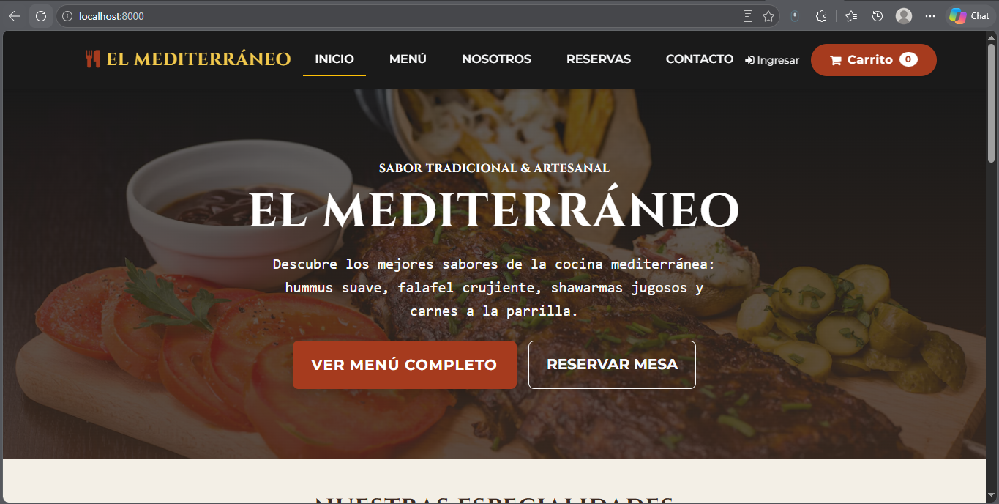
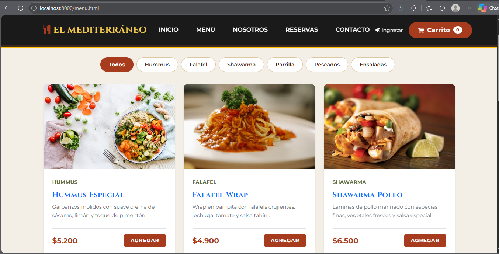

*Escritorio y móvil comparten los mismos servicios: una variación visual no genera un servicio nuevo.*

### Requisitos del caso y estado

| ID | Requisito de negocio | Pantallas | Estado |
|---|---|---|---|
| REQ-01 | Consultar la carta y filtrar por categoría | P01, P02, P03 | **Resuelto** (S01) |
| REQ-02 | Carrito de compras | P04 | **Resuelto**: el navegador solo guarda `{id, cantidad}`; precios y totales los calcula el servidor |
| REQ-03 | Pedido con delivery o retiro y pago | P05, P09 | **Resuelto** (S06–S09) |
| REQ-04 | Confirmación y consulta de pedidos | P09, P11 | **Resuelto** (S07, S08, S14) |
| REQ-05 | Reserva de mesa | P06 | **Resuelto** (S10, S11) |
| REQ-06 | Registro, ingreso y sesión segura | P10 | **Resuelto** (S02–S05). *Brecha original: no había registro → implementado.* |
| REQ-07 | Administración de la carta | P11 | **Resuelto** (S12, S13) |
| REQ-08 | Mensajes de contacto | P08 | **Resuelto** (S15, S16). *Brecha original: el formulario era una demostración → implementado.* |
| REQ-09 | Seguimiento de despacho y analítica de cocina | — | **Parcial**: servicio gRPC implementado y probado, **sin pantalla** (ver brechas) |

---

## 2. Módulo 1 — Servicios derivados del frontend

**Principio:** el navegador nunca es fuente confiable de precios, totales, roles ni estados de pago; el backend los calcula y valida.

| ID | Req. | Pantalla y acción | Verbo y ruta | Entrada | Salida / errores | Reglas | Datos | Acceso |
|---|---|---|---|---|---|---|---|---|
| **S01** | REQ-01 | P01/P02 cargar carta | `GET /public/menu` | — | `200 {products:[{id,categoria,nombre,precio,descripcion,img,stock,disponible}]}` | Solo platos disponibles con stock | Público | Anónimo |
| **S02** | REQ-06 | P10 crear cuenta | `POST /auth/register` | `{username, password, nombre_completo, email, telefono?}` | `201 {status, username}` · `409` usuario existe · `422` datos inválidos · `429` | usuario `[a-z0-9_.-]{3,32}`, contraseña 8–128, hash scrypt con sal; **el rol siempre es `user`** (cualquier campo `roles` se ignora) | Personal/Credencial | Anónimo |
| **S03** | REQ-06 | P10 ingresar | `POST /auth/login` | `{username, password}` | `200` + cookie `HttpOnly` `{status, username, roles, expires_in}` · `401` · `429` | Tiempo constante (hash señuelo si el usuario no existe), TTL 900 s | Credencial | Anónimo |
| **S04** | REQ-06 | Barra: ¿hay sesión? | `GET /auth/me` | cookie | `200 {user_id, username, roles}` · `401` | Introspección en auth_service | Restringido | Autenticado |
| **S05** | REQ-06 | Salir | `POST /auth/logout` | cookie | `200 {status}` + borra cookie | Revoca la sesión en el servidor | Restringido | Autenticado |
| **S06** | REQ-03 | P05 confirmar pedido | `POST /api/orders` | `{items:[{id,cantidad}], metodo, nombre, telefono, direccion?, notas?}` + `X-Idempotency-Key` | `201 {id, items, subtotal, envio, total, status}` · `400` delivery sin dirección · `409` sin stock · `401` · `503` inventory caído | Precios del inventario, envío $2.500 solo delivery; `status=confirmed` solo si payments aprueba, si no `pending`; misma clave ⇒ mismo pedido | Personal | Autenticado |
| **S07** | REQ-04 | P11 mis pedidos | `GET /api/orders` | cookie | `200 {orders:[…]}` | Cliente: solo los suyos; admin: todos | Personal | Autenticado |
| **S08** | REQ-04 | P09/P11 detalle | `GET /api/orders/{id}` | ruta | `200` pedido · `403` ajeno · `404` | Propiedad verificada en orders | Personal | Autenticado |
| **S09** | REQ-03 | Admin: avanzar/anular | `PATCH /api/orders/{id}/status` | `{status}` | `200` · `403` no admin · `409` transición inválida · `503` | Máquina de estados (§4); anular devuelve stock y conserva el historial | Interno | Admin |
| **S10** | REQ-05 | P06 reservar | `POST /api/reservations` | `{fecha, hora, personas 1–20, nombre, telefono}` | `201 {id, fecha, hora, personas}` · `422` | Validación de formato y capacidad | Personal | Autenticado |
| **S11** | REQ-05 | P06/P11 ver reservas | `GET /api/reservations` | cookie | `200 {reservations}` | Propias; admin todas | Personal | Autenticado |
| **S12** | REQ-07 | Admin: alta de plato | `POST /api/products` | `{categoria, nombre, precio>0, descripcion, img https, stock}` | `201` · `403` · `422` | Categorías cerradas, `img` solo https | Público | Admin |
| **S13** | REQ-07 | Admin: baja de plato | `DELETE /api/products/{id}` | ruta | `200 {deleted, status}` · `403` · `404` | **Baja lógica** (`disponible=0`): no rompe pedidos históricos | Interno | Admin |
| **S14** | REQ-04 | P09 resumen agregado | `POST /graphql` | `resumenPedido(orderId)` | `200 {data}` o `errors` | Combina orders+inventory+clients; ver §9 | Mixto | Autenticado |
| **S15** | REQ-08 | P08 enviar mensaje | `POST /public/contact` | `{nombre, email, mensaje 5–1000}` | `201 {status}` · `422` · `429` | Límite por IP; custodio: clients | Personal | Anónimo |
| **S16** | REQ-08 | Admin: leer mensajes | `GET /api/contact` | cookie | `200 {messages}` · `403` | Solo admin | Personal | Admin |
| **S17** | REQ-06 | Perfil | `GET`/`PUT /api/clients/me` | `{nombre_completo, telefono, direccion_frecuente, notas}` | `200` · `404` | Solo el titular | Personal | Autenticado |


### Contratos JSON de ejemplo (datos ficticios)

**S02 — registro** · `POST /auth/register`
```json
{ "username": "ana.demo", "password": "<mínimo 8 caracteres>", "nombre_completo": "Ana Demo",
  "email": "ana.demo@ejemplo.cl", "telefono": "+56911112222" }
```
Respuesta `201`: `{ "status": "registrado", "username": "ana.demo" }`

**S06 — crear pedido** · `POST /api/orders` con `X-Idempotency-Key: 6f1c…` y cookie de sesión
```json
{ "items": [ {"id": 1, "cantidad": 2}, {"id": 4, "cantidad": 1} ], "metodo": "delivery",
  "nombre": "Ana Demo", "telefono": "+56911112222", "direccion": "Av. Ejemplo 123, Maipú", "notas": "Timbre 402" }
```
Respuesta `201`:
```json
{ "id": 7, "user_id": "USR-6F6D8AE4", "username": "ana.demo",
  "items": [ {"id":1,"nombre":"Hummus Especial","precio":5200,"cantidad":2},
             {"id":4,"nombre":"Brochetas de Cordero Premium","precio":14500,"cantidad":1} ],
  "metodo": "delivery", "subtotal": 24900, "envio": 2500, "total": 27400, "status": "confirmed" }
```

**S15 — contacto** · `POST /public/contact`: `{ "nombre": "Visita", "email": "visita@ejemplo.cl", "mensaje": "¿Tienen opciones sin gluten?" }` → `201 {"status":"recibido"}`

---

## 3. Módulo 2 — Clases y cardinalidades del dominio

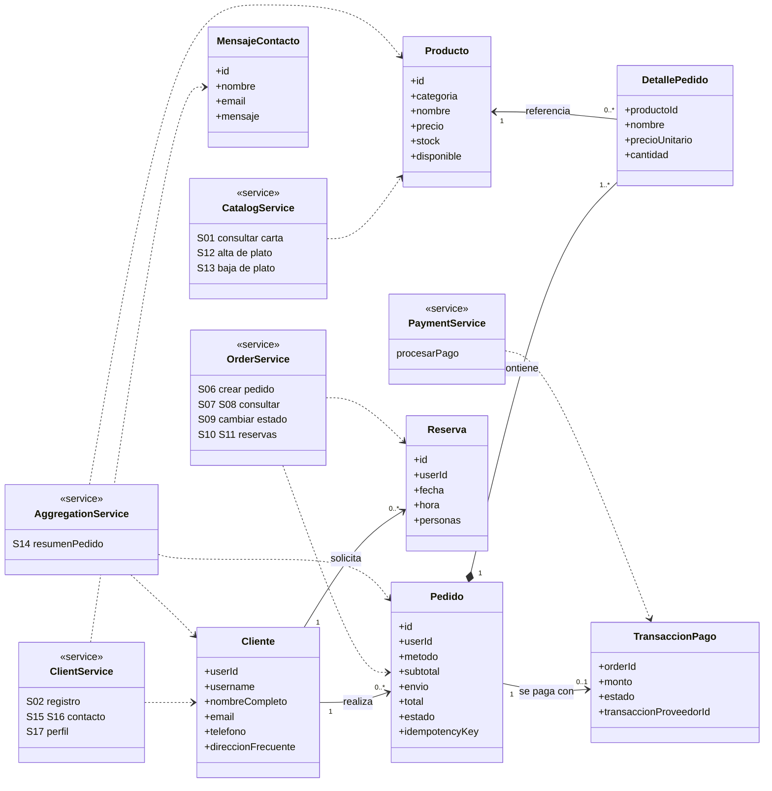

**Leyenda:** `*--` composición (el detalle no existe sin su pedido) · `-->` asociación · `..>` dependencia de uso (el servicio *usa* la clase; **no** es una relación entre registros del negocio) · `«service»` servicio público, con los IDs del módulo 1.

| Origen | Mult. | Destino | Mult. | Tipo | Regla de negocio que la justifica |
|---|---|---|---|---|---|
| Cliente | 1 | Pedido | 0..\* | Asociación | Un cliente recién registrado aún no compra (0) y puede acumular muchos pedidos; cada pedido tiene un único titular. |
| Pedido | 1 | DetallePedido | 1..\* | Composición | Un pedido confirmado contiene al menos un plato; si se anula, sus líneas no tienen existencia propia. No se modela borrador vacío: el carrito vive en el navegador como `{id, cantidad}` y **solo se convierte en Pedido al confirmarlo**. |
| Producto | 1 | DetallePedido | 0..\* | Asociación | Un plato puede no haberse pedido nunca o estar en muchos pedidos. El detalle **congela nombre y precio** al comprar; si el plato se desactiva, el historial no cambia. |
| Pedido | 1 | TransaccionPago | 0..1 | Asociación | Un pedido `pending` aún no tiene pago aprobado (0); nunca más de uno: payments devuelve `already_processed` ante un reintento. |
| Cliente | 1 | Reserva | 0..\* | Asociación | Un cliente puede reservar varias fechas; cada reserva tiene un solo titular. |

**Modelo interno vs DTO.** El modelo interno guarda `stock`, `idempotency_key`, `password_hash` y claves foráneas. Los DTO de entrada **no tienen** campos de precio, total, estado ni rol (`PedidoIn` solo admite `{id, cantidad}` + datos de entrega; `RegistroIn` no admite rol). Los DTO de salida nunca incluyen `password_hash` ni secretos.

---

## 4. Módulo 3 — Sistemas e integraciones

### Mapa de componentes y red

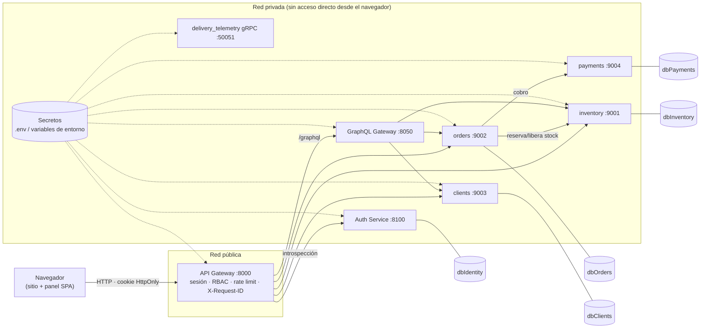

Cada servicio posee **su propia base SQLite**; ninguno lee la base de otro (colaboran solo por HTTP con contratos explícitos). En Docker, `public_net` solo contiene al gateway y `internal_mesh` es `internal: true`. En local, todos los servicios escuchan solo en `127.0.0.1`.

### Matriz de sistemas

| Sistema | Responsabilidad y autoridad | Datos que administra | Servicios | Dependencias | Contrato | Identidad requerida | Respuesta ante fallos |
|---|---|---|---|---|---|---|---|
| **inventory** | Autoridad sobre carta, precios oficiales y stock | `products` | S01, S12, S13 | — | REST/JSON síncrono (`/inventory/reserve`, `/inventory/release`) | `X-Internal-Secret` | Reserva atómica (`BEGIN IMMEDIATE`); `409` si no alcanza el stock |
| **orders** | Autoridad sobre el estado del pedido y reservas de mesa | `orders`, `order_items`, `reservations`, `idempotency_records` | S06–S11 | inventory, payments | REST/JSON síncrono | `X-Internal-Secret` + identidad propagada (`X-Authenticated-*`) | inventory caído ⇒ `503`, no se crea pedido; payments caído/rechaza ⇒ pedido `pending` (stock reservado, nunca se declara pagado) |
| **clients** | Autoridad sobre perfil, datos personales y mensajes de contacto | `clients`, `contact_messages` | S02 (perfil), S15–S17 | — | REST/JSON | `X-Internal-Secret` | `404` si no existe; no revela datos ajenos |
| **payments** | Autoridad sobre el resultado del cobro | `payments` | (interno de S06) | proveedor de pago (simulado) | REST/JSON | **Credencial propia** `PAYMENTS_SERVICE_SECRET`, que solo tiene `orders` | Idempotente: `already_processed` con el mismo código; no hay doble cobro |
| **auth_service** | Identidad, sesiones opacas, hashing | `identities`, `sessions` | S02–S05 | — | REST/JSON | `X-Introspection-Secret` (solo el gateway) | gateway ⇒ `503` si no responde |
| **graphql_gateway** | Agregación de lectura (no transaccional) | — (sin base propia) | S14 | orders, inventory, clients | GraphQL sobre HTTP | `X-Internal-Secret` + identidad | Falla parcial ⇒ `avisoParcial`, no se presenta como completo |
| **delivery_telemetry** | Telemetría y seguimiento de despacho (alta frecuencia) | en memoria (acotada) | gRPC (§10) | — | gRPC/Protobuf | metadata `x-service-secret` | `UNAUTHENTICATED`, `INVALID_ARGUMENT`, `DEADLINE_EXCEEDED` |

**Quién decide el estado oficial:** el estado del *pedido* lo decide solo `orders`; el resultado del *cobro* solo `payments`. **El frontend jamás declara un pedido como pagado**: `orders` lo marca `confirmed` únicamente si `payments` responde `approved`/`already_processed`.

### Máquina de estados del pedido (implementada y probada)

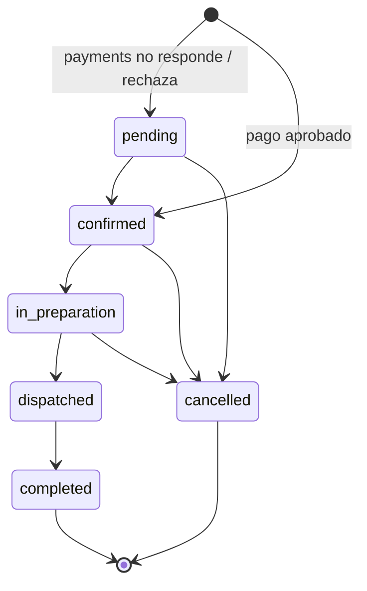
Anular (`cancelled`) llama a `inventory /inventory/release` y **conserva el registro**. Si la devolución de stock falla, la anulación no se aplica (`503`). Cualquier otra transición responde `409`.

### Secuencia: pedido exitoso

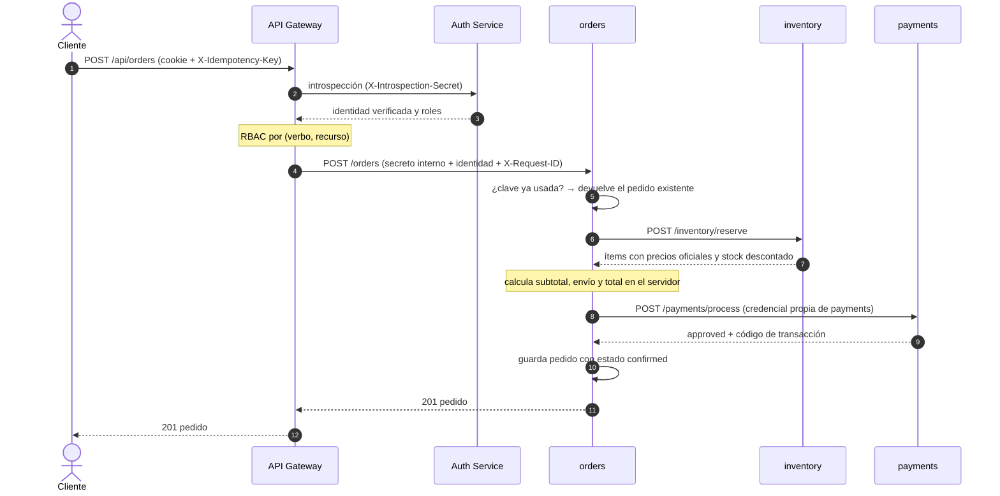

**Si payments falla:** el pedido se guarda `pending`, el stock queda reservado y el cliente ve «recibido (pago pendiente)»; un administrador puede anularlo (devuelve stock). **Si inventory falla:** `503` y no se crea ningún pedido.

---

## 5. Módulo 4 — Stakeholders y permisos HTTP

### Registro de stakeholders

| Stakeholder | Interés | Rol asociado | Uso de información |
|---|---|---|---|
| Visitante | Ver carta y precios, contactar al local | *(anónimo)* | Solo datos públicos (S01, S15) |
| Cliente registrado | Pedir, reservar, ver su historial | `user` | Sus propios pedidos, reservas y perfil |
| Administrador / operación | Mantener la carta, avanzar pedidos, leer mensajes | `admin` (incluye `user`) | Todos los pedidos y mensajes; no ve contraseñas |
| Dueño / supervisor | Revisa ventas y cumplimiento | **sin permisos operativos** | Recibe informes que genera el administrador; **no tiene cuenta ni accede a la API** |
| Repartidor / pantalla de cocina | Enviar posición, ver estado | **identidad técnica** (gRPC) | Solo el servicio gRPC con secreto de servicio; no usa la API HTTP |
| Pasarela de pagos | Cobrar | **identidad de sistema** (simulada) | Solo la conoce `payments` |
| Servicios internos | Colaborar entre sí | **identidades técnicas** (secretos §7) | Cada una con su credencial y alcance |

### Matriz de permisos (verbo × ruta)

`✔` permitido · `✔*` permitido con condición · `✖` denegado (401 sin sesión / 403 sin rol) · `—` no aplica. **Se verifica en el gateway (RBAC) y se vuelve a verificar en el servicio dueño del recurso.**

| ID | Ruta | Verbo | Anónimo | `user` | `admin` | Condición | Verifica |
|---|---|---|---|---|---|---|---|
| S01 | `/public/menu` | GET | ✔ | ✔ | ✔ | Solo campos públicos | Gateway |
| S02 | `/auth/register` | POST | ✔ | ✔ | ✔ | Rol fijado por el servidor | Gateway + auth |
| S03 | `/auth/login` | POST | ✔ | ✔ | ✔ | Rate limit por IP | Gateway |
| S04/S05 | `/auth/me`, `/auth/logout` | GET/POST | ✖ | ✔ | ✔ | Sesión vigente | Gateway + auth |
| S06 | `/api/orders` | POST | ✖ | ✔ | ✔ | Precios calculados en el servidor | Gateway + orders |
| S07 | `/api/orders` | GET | ✖ | ✔* | ✔ | `user`: solo `user_id == titular` | **orders** |
| S08 | `/api/orders/{id}` | GET | ✖ | ✔* | ✔ | `403` si el pedido es de otro | **orders** |
| S09 | `/api/orders/{id}/status` | PATCH | ✖ | ✖ | ✔* | Solo transiciones válidas (`409`) | Gateway + orders |
| — | `/api/orders` · `/{id}` | PUT / DELETE | ✖ | ✖ | ✖ | **No existen** (los pedidos se anulan, no se borran) | — |
| S10/S11 | `/api/reservations` | POST/GET | ✖ | ✔* | ✔ | `user`: solo las suyas | orders |
| S12 | `/api/products` | POST | ✖ | **✖** | ✔ | Validación de datos | Gateway + inventory |
| S13 | `/api/products/{id}` | DELETE | ✖ | **✖** | ✔ | Baja lógica | Gateway + inventory |
| S14 | `/graphql` | POST | ✔* | ✔* | ✔* | Catálogo público; `resumenPedido` exige identidad y dueño del pedido (o admin) | GraphQL + orders |
| S15 | `/public/contact` | POST | ✔ | ✔ | ✔ | Rate limit por IP | Gateway |
| S16 | `/api/contact` | GET | ✖ | ✖ | ✔ | Solo admin | Gateway + clients |
| S17 | `/api/clients/me` | GET/PUT | ✖ | ✔* | ✔* | Solo el titular | clients |
| — | `/api/payments/*` | cualquiera | ✖ | ✖ | **✖** | Ningún rol: payments es solo interno de orders | Gateway |

**Anular un pedido no equivale a borrarlo:** `cancelled` es un estado terminal que conserva el historial y devuelve el stock. **Ocultar un botón no sustituye el control**: la captura siguiente es el panel de administración visto con una cuenta `user`, donde el *backend* responde 403 aunque se abra la URL a mano.

| Admin (`administrador1`) | Misma URL con un cliente (`user`) |
|---|---|
| 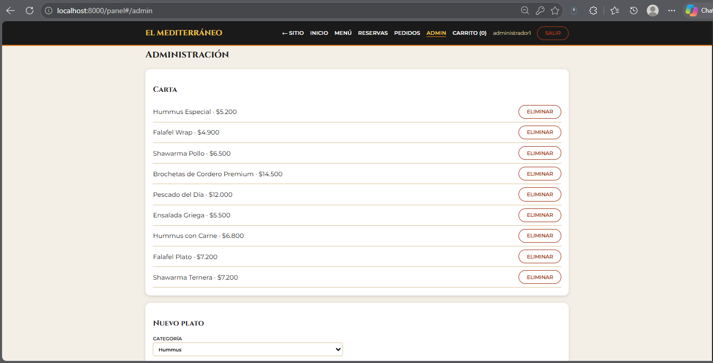 | 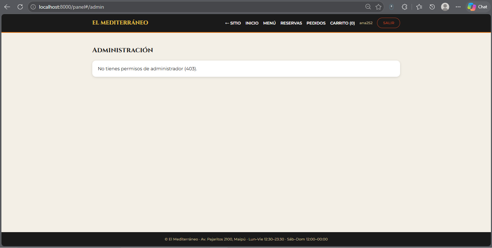 |

---

## 6. Módulo 5 — Clases del API Gateway

**Decisión: un único API Gateway.** Concentra las políticas (sesión, RBAC, límites, correlación) en un solo punto, evita reglas duplicadas o contradictorias y garantiza que el navegador nunca conozca la red privada. Las rutas se separan por *políticas* (públicas, autenticadas, administrativas), no por gateways distintos. El **GraphQL Gateway** es un componente aparte porque tiene otra naturaleza (agregación de lectura) y permanece en la red privada.

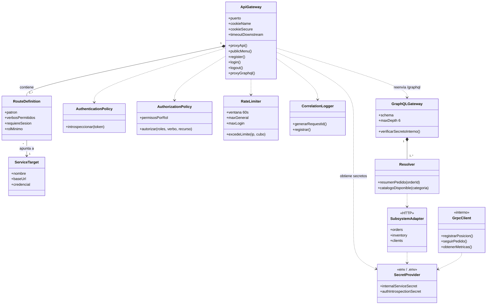

*Relaciones estructurales* (composición/asociación con multiplicidad): `ApiGateway 1─1..* RouteDefinition`, `GraphQLGateway 1─1..* Resolver`. *Dependencias de comunicación* (líneas punteadas): llamadas a políticas, al proveedor de secretos y a subsistemas; **no** implican relación entre registros. En el código, las rutas están en `gateway.py` (`resolver_destino_microservicio`) y las políticas en `PERMISOS_POR_ROL`, `autorizar_rbac`, `introspect_session`, `correlacion_y_limites`.

### Fronteras de confianza — qué valida cada capa

| Capa | Valida | **No** confía en |
|---|---|---|
| **API Gateway** | Cookie → introspección con auth_service; RBAC por (verbo, recurso); rate limit por IP; rutas y verbos admitidos (lista blanca, sin redirección genérica; `..` rechazado); descarta cabeceras `X-Authenticated-*`/`X-Internal-Secret` del navegador y **las reconstruye** con identidad verificada; timeouts de 8 s; CSP | Cualquier cabecera o identidad enviada por el navegador |
| **Servicios privados** | Secreto interno (`403` sin él); propiedad del recurso; reglas de negocio; validación de datos | Que la petición venga «de adentro»: **repiten** las comprobaciones |
| **GraphQL Gateway** | Secreto interno; profundidad ≤ 6; identidad obligatoria para `resumenPedido` | Datos de usuario por defecto (no los hay) |

**Solicitud autorizada** (`ana` lee su pedido): cookie → gateway introspecta → RBAC `user` puede `GET orders` → reenvía a orders con secreto interno e identidad verificada → orders comprueba `pedido.user_id == ana` → `200`.

**Solicitud denegada** (`ana` crea un plato): gateway introspecta → RBAC: `POST products` solo para `admin` → **`403` sin llamar a inventory**. Y si alguien llamara a inventory directo (sin pasar por el gateway), este responde `403` por falta de secreto (probado en vivo, §11).

---

## 7. Módulo 6 — Rutas y secretos de integración

### Matriz de rutas (lista explícita; no se publican endpoints internos)

| ID | Verbo | Ruta externa | Acceso | Destino interno | Controles | Credencial (ref.) |
|---|---|---|---|---|---|---|
| R01 | GET | `/public/menu` | Anónimo | inventory `GET /products?available_only=true` | filtro de disponibles, rate limit general | `SEC-INTERNAL` |
| R02 | POST | `/auth/register` | Anónimo | auth `POST /register` → clients `POST /clients` (compensación `DELETE /identities/{id}` si falla) | validación, rate limit propio, rol fijo | `SEC-AUTH-INTROSPECT`, `SEC-INTERNAL` |
| R03 | POST | `/auth/login` | Anónimo | auth `POST /login` | rate limit **5/min/IP**, scrypt, cookie `HttpOnly` | — (punto de entrada) |
| R04 | GET | `/auth/me` | Sesión | auth `POST /introspect` | cookie vigente | `SEC-AUTH-INTROSPECT` |
| R05 | POST | `/auth/logout` | Sesión | auth `POST /logout` | revoca sesión | `SEC-AUTH-INTROSPECT` |
| R06 | POST | `/public/contact` | Anónimo | clients `POST /contact` | validación, rate limit | `SEC-INTERNAL` |
| R07 | POST | `/graphql` | Anónimo/Sesión | graphql_gateway `/graphql` | ver tabla GraphQL | `SEC-INTERNAL` |
| R08 | GET/POST/PATCH | `/api/orders`, `/api/orders/{id}`, `/api/orders/{id}/status`, `/api/reservations` | Sesión (`PATCH`: admin) | orders `/orders…`, `/reservations` | RBAC, idempotencia, propiedad | `SEC-INTERNAL` |
| R09 | GET/POST/DELETE | `/api/products[/{id}]` | Sesión (`POST`/`DELETE`: admin) | inventory `/products…` | RBAC, validación | `SEC-INTERNAL` |
| R10 | GET/PUT | `/api/clients/me` | Sesión | clients `/clients/me` | solo titular | `SEC-INTERNAL` |
| R11 | GET | `/api/contact` | Admin | clients `GET /contact` | RBAC + verificación en clients | `SEC-INTERNAL` |
| — | cualquiera | `/api/payments/*` | **nadie** | payments | `403` para todo rol | — |
| — | — | orders → payments `POST /payments/process` | interno | payments | idempotencia | `SEC-PAYMENTS` (solo orders) |

### GraphQL (operaciones, campos autorizados y resolvers)

| Operación | Tipo | Campos autorizados | Resolver | Subsistemas | Autorización |
|---|---|---|---|---|---|
| `catalogoDisponible(categoria)` | Query | `id, categoria, nombre, precio, descripcion, img, stock, disponible` | `catalogo_disponible` | inventory | Pública (datos públicos) |
| `resumenPedido(orderId)` | Query | `orderId, status, subtotal, envio, total, items{…}, cliente{nombreCompleto, email, telefono, direccionFrecuente}, avisoParcial` | `resumen_pedido` | **orders + inventory + clients** | Identidad obligatoria; solo el dueño del pedido o `admin` (lo decide orders) |

No hay *Mutations*: las reglas transaccionales permanecen en los servicios REST.

### gRPC (servicio y métodos)

| Servicio · método | Entrada → salida | Modalidad | Identidad permitida | Plazo |
|---|---|---|---|---|
| `DeliveryTelemetryService.RegisterLocation` | `LocationUpdate → LocationResponse` | Unary | `x-service-secret` | cliente: 2–3 s |
| `DeliveryTelemetryService.StreamOrderTracking` | `TrackingRequest → stream TrackingEvent` | Server streaming | `x-service-secret` | cliente: 10 s; el servidor corta si vence |
| `DeliveryTelemetryService.GetKitchenMetrics` | `KitchenMetricsRequest → KitchenMetricsResponse` | Unary | `x-service-secret` | cliente: 2–3 s |

### Inventario simbólico de secretos e identidades (nunca valores reales)

| Referencia | Tipo | Emisor | Consumidor | Finalidad | Ubicación | Alcance | Rotación / revocación |
|---|---|---|---|---|---|---|---|
| `SEC-INTERNAL` (`INTERNAL_SERVICE_SECRET`) | Secreto compartido de servicio | `cargar-env.ps1` (aleatorio, 24 bytes) | Gateway → inventory, orders, clients, graphql; orders → inventory | Probar que la llamada viene del gateway | `.env` no versionado / variables del proceso o de Compose | Servicios de negocio **excepto payments** | Regenerar `.env` y reiniciar; ante filtración, rotación inmediata |
| `SEC-AUTH-INTROSPECT` (`AUTH_INTROSPECTION_SECRET`) | Secreto de servicio | ídem | Gateway → auth_service | Introspección, logout, registro | ídem | Solo auth_service | ídem |
| `SEC-PAYMENTS` (`PAYMENTS_SERVICE_SECRET`) | Secreto de servicio | ídem | **Solo orders** → payments | Autorizar cobros | ídem | Solo payments | ídem; el gateway **no** lo posee |
| `SEC-GRPC` (`GRPC_SERVICE_SECRET`) | Secreto de servicio (metadata) | ídem | Clientes gRPC internos | Autenticar llamadas gRPC | ídem | Solo delivery_telemetry | ídem |
| `SEC-SESSION` | Token de sesión opaco (32 bytes) | auth_service | Navegador (cookie `HttpOnly`, `SameSite=Lax`) | Mantener sesión | Cookie; tabla `sessions` | Titular | Expira a los 900 s; `logout` la revoca |
| `SEC-DB-*` | Archivo SQLite por servicio | — | Solo su servicio | Persistencia aislada | Carpeta del servicio | Un solo servicio | Permisos del sistema de archivos |

Los secretos **no** van en rutas, query strings, repositorio, capturas ni logs (verificado por pruebas automáticas, §11). **Si se filtra una clave:** se regenera `.env` y se reinician los procesos (sesiones se invalidan reiniciando auth). **Si el «gestor» de secretos no está disponible** (archivo/variable ausente): los servicios no arrancan en vez de usar un valor por defecto.

---

## 8. Módulo 7 — Datos sensibles y secretos del cliente

| Dato | Finalidad | Clasificación | Custodio | Roles autorizados | En el frontend | Protección | Retención |
|---|---|---|---|---|---|---|---|
| Carta, precios, descripciones | Vender | **Público** | inventory | Todos | Visible | Solo lectura | Permanente |
| Contraseña | Autenticar | **Credencial crítica** | auth_service | Nadie (solo se verifica) | Campo `password`; jamás se devuelve | **scrypt** (n=2¹⁴, r=8, p=1) con sal única de 16 bytes; no reversible | Mientras exista la cuenta |
| Token de sesión | Mantener sesión | Credencial temporal | auth_service | Titular | **Cookie `HttpOnly`** (inaccesible a JavaScript); *no se usa `localStorage`* | TTL 900 s, revocable, valor opaco aleatorio | Hasta logout o expiración |
| Correo, teléfono, nombre | Contacto y despacho | **Personal restringido** | clients | Titular y admin | Solo en perfil, pedido y confirmación | Validación en servidor; `GET /clients/{id}` solo admin | Vida de la cuenta |
| Dirección de entrega | Despachar | Personal restringido | orders / clients | Titular del pedido y admin | Solo en formulario y pedido propio | No aparece en el catálogo; filtrada por titular | Ciclo del pedido |
| Historial de pedidos | Seguimiento | Personal restringido | orders | Titular y admin | Solo «Mis pedidos» | Filtro por `user_id` en el servicio | Se conserva (anulación ≠ borrado) |
| Mensajes de contacto | Atención | Personal restringido | clients | Solo admin | No se muestran a terceros | `GET /api/contact` solo admin | Hasta su atención |
| Datos de tarjeta | Cobrar | **Secreto financiero** | *(no se custodia)* | — | **No existen en el sistema** | — | Retención cero |
| Secretos de integración | Autenticar servicios | Secreto técnico | Variables de entorno | Procesos autorizados | **Nunca llegan al navegador** | §7 | §7 |

**Decisión explícita sobre secretos del cliente: NO custodiamos secretos financieros ni claves del cliente.** El cobro se delega a una pasarela que entrega solo un identificador de transacción (`transaccion_proveedor_id`).

**Recorrido de un dato restringido (la dirección):** se captura en P05 (HTTPS en despliegue) → viaja en el cuerpo de `POST /api/orders`, nunca en la URL → el gateway verifica la sesión → orders valida que `delivery` exija dirección y la guarda en `dbOrders.sqlite` → solo el titular y el admin pueden leerla (S07/S08) → los logs **no** registran cuerpo ni query → se conserva con el pedido (necesaria para el historial y la boleta) y no se borra al anular.

### Casos de validación ejecutados contra el backend

| # | Caso | Entrada | Esperado | **Resultado real** | Lo verifica |
|---|---|---|---|---|---|
| V1 | Catálogo anónimo | `GET /public/menu` sin sesión | 200 | **200** | gateway |
| V2 | Operación protegida sin sesión | `GET /api/orders` | 401 | **401** | gateway |
| V3 | Administración con rol sin permiso | `ana` → `POST /api/products` | 403 | **403** | gateway (RBAC) |
| V4 | Pedido ajeno | otro usuario → `GET /api/orders/{id}` o GraphQL `resumenPedido` | 403 / error sin datos | **403 / `Acceso denegado`, `data:null`** | orders |
| V5 | Acceso directo al backend | `GET :19001/products` y `:19002/orders` sin secreto; `POST :8050/graphql` sin secreto | 403 | **403 / 403 / 403** | cada servicio |
| V6 | Pago/precio alterado desde el frontend | `{"cantidad":1,"precio":1}` | se ignora | **total = $5.200 (precio oficial), `confirmed`** | orders + payments |
| V7 | Escalada de rol al registrarse | `POST /auth/register` con `"roles":["admin"]` | rol `user` | **`/auth/me` → `["user"]`; `POST /api/products` → 403** | auth_service |
| V8 | payments con el secreto del gateway | `GET payments` con `SEC-INTERNAL` | 403 | **403** | payments |

(Las capturas de V4/V3: [`10-sin-permiso`](docs/img/10-sin-permiso.png).)

---

## 9. Módulo 8 — Separación privada y agregaciones GraphQL

### Mapa de clasificación de servicios

| Servicio | Naturaleza | Responsabilidad | Datos propios | Contrato | Dependencias | Por qué está separado |
|---|---|---|---|---|---|---|
| inventory | Transaccional | Carta y stock | `products` | REST | — | Cambia por razones distintas (carta/stock) y tiene reservas concurrentes que exigen atomicidad propia |
| orders | Transaccional | Pedidos, reservas, estados | `orders…` | REST | inventory, payments | Es el único que decide el estado del pedido |
| clients | Transaccional | Perfiles y contacto | `clients`, `contact_messages` | REST | — | Concentra los datos personales (mayor exigencia de privacidad) |
| payments | Transaccional (sensible) | Cobro | `payments` | REST | — | Credencial propia y mínima superficie |
| auth_service | Identidad | Cuentas y sesiones | `identities`, `sessions` | REST | — | Aísla credenciales de la lógica de negocio |
| graphql_gateway | **Agregación** | Compone lectura de varios sistemas | ninguno | GraphQL | orders, inventory, clients | Evita *over/under-fetching* sin dar acceso a bases ajenas |
| delivery_telemetry | **Alta demanda / analítica** | GPS y seguimiento | memoria acotada | gRPC | — | Otra carga y otro protocolo (§10) |

*No se dividió «una tabla = un servicio»: cada frontera sigue cohesión, propiedad de datos y razón de cambio.*

### Schema (resumen) y consulta de prueba

```graphql
type Query {
  catalogoDisponible(categoria: String): [ProductoDetalle!]!
  resumenPedido(orderId: Int!): ResumenPedidoAgregado
}
type ResumenPedidoAgregado { orderId: Int!  userId: String!  username: String!  metodo: String!  status: String!
  subtotal: Int!  envio: Int!  total: Int!  items: [ItemPedidoAgregado!]!  cliente: ClienteResumen  avisoParcial: String }
```

```graphql
query ($id: Int!) {
  resumenPedido(orderId: $id) {
    orderId status total
    cliente { nombreCompleto email }
    items { nombre categoria subtotalLinea }
  }
}
```
Respuesta real obtenida en la ejecución (datos de prueba):
```json
{"data":{"resumenPedido":{"orderId":44,"status":"confirmed","total":5200,
  "cliente":{"nombreCompleto":"Persona Demo","email":"demo779b22@ejemplo.cl"},
  "items":[{"nombre":"Hummus Especial","categoria":"hummus"}]}}}
```
`pedido` viene de **orders**, `categoria` de **inventory** y el titular de **clients**: tres subsistemas en una sola petición.

### Controles y autorización

| Control | Implementación |
|---|---|
| Servicio privado | Exige `X-Internal-Secret` (`403` en llamada directa) |
| Identidad | `resumenPedido` **exige** identidad verificada por el gateway; **sin identidad → error, `data: null`** (no hay usuario por defecto) |
| Autorización por recurso | La resuelve **orders** (dueño o admin); un tercero recibe error sin datos |
| Campos | El esquema solo expone los campos de la tabla; no incluye `password_hash`, `stock` interno de pedidos ni secretos |
| Profundidad | Límite 6 (`400` si se supera) |
| Errores parciales | Si inventory/clients fallan, se devuelve lo básico con `avisoParcial`, no un resumen «completo» falso |
| Plazos | 4 s por llamada a subsistemas |

### Evidencia desde el frontend

La pantalla **P09 Confirmación** ejecuta `resumenPedido` a través del API Gateway (`POST /graphql`, puerto 8000) y muestra el resultado en la tarjeta *«Resumen verificado por el servidor»* (titular desde `clients`, estado desde `orders`, categorías desde `inventory`). El navegador no puede invocar el puerto 8050 (privado).

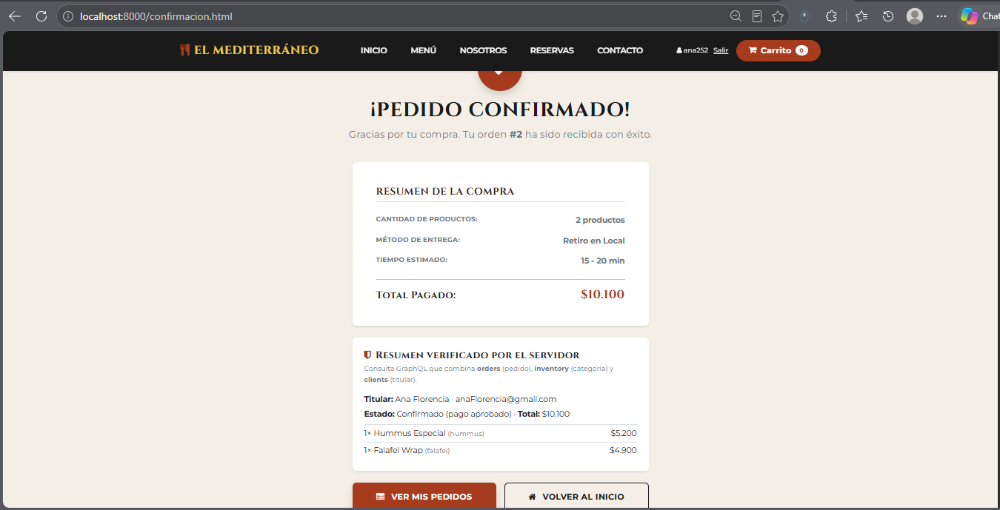

---

## 10. Módulo 9 — Analítica y comunicación gRPC

### ADR — Aplicabilidad de gRPC y analítica operativa

* **Estado:** aceptado e implementado.
* **Contexto:** en hora punta (almuerzo y cena) los repartidores envían su posición con alta frecuencia y los clientes/cocina consultan el avance. Objetivo declarado: **≥ 50 actualizaciones/s, p95 < 10 ms, 0 errores**.
* **Alternativas:** (1) *polling REST cada pocos segundos* — más cabeceras y conexiones, sin streaming real; (2) **gRPC/HTTP-2 con Protobuf y server streaming** — contrato tipado, una conexión multiplexada, streaming nativo.
* **Decisión:** servicio privado `delivery_telemetry` (gRPC, `delivery.proto`): `RegisterLocation` (unary), `StreamOrderTracking` (server streaming), `GetKitchenMetrics` (unary).
* **Consecuencias:** contrato tipado y streaming; **no se afirma una mejora de ancho de banda ni de CPU respecto de REST porque no se comparó**. El navegador no habla gRPC: si el frontend necesitara los eventos, se expondrían mediante un adaptador del gateway (no implementado, ver brechas).
* **Controles implementados:** secreto de servicio en la metadata (`UNAUTHENTICATED` si falta o es incorrecto), escucha solo en `127.0.0.1` (en contenedor, red interna), validación de entradas (`INVALID_ARGUMENT`), **deadline** (el stream termina con `DEADLINE_EXCEEDED`), tamaño máximo de mensaje 64 KB, 100 RPC concurrentes máximo, memoria acotada (`deque` de 10 000 posiciones).

### Matriz de necesidades

| Aspecto | Necesidad | Solución |
|---|---|---|
| Volumen/frecuencia | ~50 posiciones GPS/s en hora punta | `RegisterLocation` unary con mensajes Protobuf pequeños |
| Streaming | Seguimiento reactivo del pedido | `StreamOrderTracking` (server streaming) con corte por deadline/cancelación |
| Latencia | < 10 ms p95 en red interna | Canal HTTP/2 persistente |
| Analítica de cocina | Métricas operativas | `GetKitchenMetrics` (**valores de demostración**, ver brechas) |

### Prueba de carga (**medición real y reproducible**, no proyección)

`python services\delivery_telemetry\load_test.py` contra el servidor gRPC en ejecución (autenticado). Resultados guardados en `load_test_results.json`:

| Parámetro | Valor |
|---|---|
| Entorno | Windows 10, Python 3.12.2, 4 CPU lógicas, todo en el mismo equipo |
| Carga | 3 000 peticiones `RegisterLocation`, 10 hilos concurrentes, 2,06 s |
| Éxito / errores | 3 000 / 3 000 (100 %) · 0 errores |
| Throughput | **1 458,5 req/s** |
| Latencia | promedio 6,76 ms · p50 6,37 ms · **p95 7,95 ms** · p99 9,47 ms |
| Recursos del servidor | CPU media 165 % (≈1,65 núcleos; el medidor suma núcleos) · máx. 182 % · memoria máx. **33,5 MB** |
| Objetivos (≥ 50 req/s, p95 ≤ 10 ms, 0 errores) | **Cumplidos** |

*Limitaciones:* cliente y servidor comparten máquina, la duración es corta (≈2 s) y los datos son sintéticos; sirve para validar el objetivo declarado, no para dimensionar producción.

---

## 11. Módulo 10 — Backend completo e integración verificable

* **Persistencia real:** 5 bases SQLite aisladas, creadas por script (`scripts\sembrar_datos.py` / `init_db()`) con datos ficticios; nada se simula en memoria salvo la telemetría gRPC.
* **Integración:** el frontend (sitio y panel) consume solo `/public/*`, `/auth/*`, `/api/*` y `/graphql` del gateway; sesión por cookie `HttpOnly`, **sin tokens en `localStorage`**, y las pruebas de la UI se hicieron con el sistema real.
* **Pruebas:** 41 automatizadas (pytest) sobre **bases de datos temporales aisladas**, con secretos aleatorios por sesión; repetibles (se ejecutaron varias veces seguidas con el mismo resultado).

### Matriz requisito → pantalla → servicio → prueba → resultado

| Req. | Pantalla | Servicio | Prueba automatizada (`tests/`) | Resultado |
|---|---|---|---|---|
| REQ-01 | P02 | S01 | `test_e2e_stack::test_gateway_public_menu` | ✔ PASSED |
| REQ-01/09 | — | S14 | `test_graphql_aggregation::test_catalogo_disponible_graphql` | ✔ PASSED |
| REQ-02/03 | P04, P05 | S06 | `test_services_isolation::test_calculo_estricto_de_precios_y_totales_en_servidor` | ✔ PASSED |
| REQ-03 | P05 | S06 | `test_services_isolation::test_control_de_idempotencia_sin_duplicar_pedido` | ✔ PASSED |
| REQ-03 | P05 | S06 | `test_services_isolation::test_validacion_de_metodo_delivery_exige_direccion` | ✔ PASSED |
| REQ-03 | P05 | inventory | `test_services_isolation::test_reserva_y_conflicto_de_stock_insuficiente` | ✔ PASSED |
| REQ-03 | P05 | payments | `test_services_isolation::test_pagos_previene_doble_transaccion` | ✔ PASSED |
| REQ-03 | P05, P09 | S06 | `test_registro_y_negocio::test_pedido_con_pago_aprobado_queda_confirmado` | ✔ PASSED |
| REQ-03 | P09 | S06 | `test_registro_y_negocio::test_pedido_queda_pendiente_si_payments_no_responde` | ✔ PASSED |
| REQ-03 | P11 | S09 | `test_registro_y_negocio::test_transiciones_invalidas_y_cancelacion_devuelve_stock` | ✔ PASSED |
| REQ-04 | P09/P11 | S08 | `test_security_auth::test_control_de_propiedad_de_recursos_recurso_ajeno` | ✔ PASSED |
| REQ-04 | P09 | S14 | `test_graphql_aggregation::test_agregacion_resumen_pedido_combina_tres_sistemas` | ✔ PASSED |
| REQ-04 | P09 | S14 | `test_graphql_aggregation::test_resumen_de_pedido_ajeno_no_filtra_datos` | ✔ PASSED |
| REQ-04 | — | S14 | `test_graphql_aggregation::test_limite_de_profundidad_rechaza_consulta_abusiva` | ✔ PASSED |
| REQ-04 | — | S14 | `test_registro_y_negocio::test_graphql_privado_rechaza_llamada_directa_sin_secreto` | ✔ PASSED |
| REQ-04 | P09 | S14 | `test_registro_y_negocio::test_graphql_resumen_exige_identidad_verificada` | ✔ PASSED |
| REQ-06 | P10 | S02 | `test_registro_y_negocio::test_registro_crea_cuenta_con_rol_user_y_perfil` | ✔ PASSED |
| REQ-06 | P10 | S02 | `test_registro_y_negocio::test_registro_rechaza_duplicados_y_datos_invalidos` | ✔ PASSED |
| REQ-06 | P10 | S02 | `test_registro_y_negocio::test_registro_tiene_rate_limit` | ✔ PASSED |
| REQ-06 | P10 | S02 | `test_registro_y_negocio::test_contrasena_se_guarda_con_hash_no_reversible` | ✔ PASSED |
| REQ-06 | P10 | S03 | `test_security_auth::test_login_exitoso_y_credenciales_invalidas` | ✔ PASSED |
| REQ-06 | — | S03 | `test_security_auth::test_password_hashing_scrypt_no_reversible` | ✔ PASSED |
| REQ-06 | P10 | S03–S05 | `test_e2e_stack::test_gateway_flujo_login_y_proteccion_de_rutas` | ✔ PASSED |
| REQ-06 | — | auth | `test_security_auth::test_introspeccion_exige_secreto_de_servicio` | ✔ PASSED |
| REQ-07 | P11 | S12/S13 | `test_security_auth::test_rbac_solo_administrador_puede_agregar_o_eliminar_platos` | ✔ PASSED |
| Seguridad | — | todos | `test_security_auth::test_rechazo_de_acceso_directo_a_microservicios_privados` | ✔ PASSED |
| Seguridad | — | payments | `test_registro_y_negocio::test_payments_no_acepta_el_secreto_interno_del_gateway` · `test_gateway_no_enruta_payments_a_ningun_rol` | ✔ PASSED |
| REQ-08 | P08 | S15/S16 | `test_registro_y_negocio::test_contacto_publico_se_guarda_y_solo_admin_lo_lee` · `test_contacto_tiene_rate_limit` | ✔ PASSED |
| Seguridad | — | gateway | `test_hardening::test_rate_limit_de_login_devuelve_429` · `…x_request_id…` · `…logs_no_contienen_secretos_ni_cookies` | ✔ PASSED |
| Seguridad | — | todos | `test_hardening::test_no_hay_secretos_incrustados_en_codigo_ni_configuracion` · `…servicio_falla_al_arrancar_sin_secreto` | ✔ PASSED |
| REQ-09 | — | gRPC | `test_grpc_delivery::` `unary_register_location` · `server_streaming_tracking` · `kitchen_analytics_metrics` · `rechaza_llamadas_sin_identidad_de_servicio` · `valida_entradas_y_deadline` · `memoria_acotada` | ✔ PASSED |

**Total: 41 pruebas, 41 aprobadas.**

#### Salida real de la ejecución

Resultado textual de `python -m pytest tests -v`, ejecutado el 09-nov-2026 (solo se omitieron rutas personales del equipo). Cada línea corresponde a una fila de la matriz anterior:

```text
============================= test session starts =============================
platform win32 -- Python 3.12.2, pytest-9.2.0, pluggy-1.7.0 -- python.exe
rootdir: Evaluación 2
plugins: platformdirs-4.14.5, anyio-4.15.1
collecting ... collected 41 items

tests/test_e2e_stack.py::test_gateway_public_menu PASSED                 [  2%]
tests/test_e2e_stack.py::test_gateway_flujo_login_y_proteccion_de_rutas PASSED [  4%]
tests/test_graphql_aggregation.py::test_catalogo_disponible_graphql PASSED [  7%]
tests/test_graphql_aggregation.py::test_limite_de_profundidad_rechaza_consulta_abusiva PASSED [  9%]
tests/test_graphql_aggregation.py::test_agregacion_resumen_pedido_combina_tres_sistemas PASSED [ 12%]
tests/test_graphql_aggregation.py::test_resumen_de_pedido_ajeno_no_filtra_datos PASSED [ 14%]
tests/test_grpc_delivery.py::test_grpc_rechaza_llamadas_sin_identidad_de_servicio PASSED [ 17%]
tests/test_grpc_delivery.py::test_grpc_valida_entradas_y_deadline PASSED [ 19%]
tests/test_grpc_delivery.py::test_grpc_memoria_acotada PASSED            [ 21%]
tests/test_grpc_delivery.py::test_grpc_unary_register_location PASSED    [ 24%]
tests/test_grpc_delivery.py::test_grpc_server_streaming_tracking PASSED  [ 26%]
tests/test_grpc_delivery.py::test_grpc_kitchen_analytics_metrics PASSED  [ 29%]
tests/test_hardening.py::test_no_hay_secretos_incrustados_en_codigo_ni_configuracion PASSED [ 31%]
tests/test_hardening.py::test_servicio_falla_al_arrancar_sin_secreto PASSED [ 34%]
tests/test_hardening.py::test_rate_limit_de_login_devuelve_429 PASSED    [ 36%]
tests/test_hardening.py::test_respuestas_llevan_x_request_id_y_se_respeta_el_valido PASSED [ 39%]
tests/test_hardening.py::test_logs_no_contienen_secretos_ni_cookies PASSED [ 41%]
tests/test_registro_y_negocio.py::test_registro_crea_cuenta_con_rol_user_y_perfil PASSED [ 43%]
tests/test_registro_y_negocio.py::test_registro_rechaza_duplicados_y_datos_invalidos PASSED [ 46%]
tests/test_registro_y_negocio.py::test_registro_tiene_rate_limit PASSED  [ 48%]
tests/test_registro_y_negocio.py::test_contrasena_se_guarda_con_hash_no_reversible PASSED [ 51%]
tests/test_registro_y_negocio.py::test_graphql_privado_rechaza_llamada_directa_sin_secreto PASSED [ 53%]
tests/test_registro_y_negocio.py::test_graphql_resumen_exige_identidad_verificada PASSED [ 56%]
tests/test_registro_y_negocio.py::test_payments_no_acepta_el_secreto_interno_del_gateway PASSED [ 58%]
tests/test_registro_y_negocio.py::test_gateway_no_enruta_payments_a_ningun_rol PASSED [ 60%]
tests/test_registro_y_negocio.py::test_pedido_con_pago_aprobado_queda_confirmado PASSED [ 63%]
tests/test_registro_y_negocio.py::test_pedido_queda_pendiente_si_payments_no_responde PASSED [ 65%]
tests/test_registro_y_negocio.py::test_transiciones_invalidas_y_cancelacion_devuelve_stock PASSED [ 68%]
tests/test_registro_y_negocio.py::test_contacto_publico_se_guarda_y_solo_admin_lo_lee PASSED [ 70%]
tests/test_registro_y_negocio.py::test_contacto_tiene_rate_limit PASSED  [ 73%]
tests/test_security_auth.py::test_password_hashing_scrypt_no_reversible PASSED [ 75%]
tests/test_security_auth.py::test_login_exitoso_y_credenciales_invalidas PASSED [ 78%]
tests/test_security_auth.py::test_introspeccion_exige_secreto_de_servicio PASSED [ 80%]
tests/test_security_auth.py::test_rechazo_de_acceso_directo_a_microservicios_privados PASSED [ 82%]
tests/test_security_auth.py::test_control_de_propiedad_de_recursos_recurso_ajeno PASSED [ 85%]
tests/test_security_auth.py::test_rbac_solo_administrador_puede_agregar_o_eliminar_platos PASSED [ 87%]
tests/test_services_isolation.py::test_calculo_estricto_de_precios_y_totales_en_servidor PASSED [ 90%]
tests/test_services_isolation.py::test_control_de_idempotencia_sin_duplicar_pedido PASSED [ 92%]
tests/test_services_isolation.py::test_reserva_y_conflicto_de_stock_insuficiente PASSED [ 95%]
tests/test_services_isolation.py::test_validacion_de_metodo_delivery_exige_direccion PASSED [ 97%]
tests/test_services_isolation.py::test_pagos_previene_doble_transaccion PASSED [100%]

============================= 41 passed in 49.35s =============================
```


### Verificación contra el sistema real en ejecución (procesos y puertos reales)

Además de las pruebas automatizadas, se levantó la plataforma con `iniciar-todo.ps1` y se ejecutaron peticiones reales (resultados observados):

| Caso | Resultado |
|---|---|
| Registro (con intento `roles:["admin"]`) · duplicado · contraseña corta | `201` · `409` · `422` |
| `/auth/me` del usuario nuevo | `roles: ["user"]` |
| Perfil propio `/api/clients/me` · nuevo usuario `POST /api/products` | `200` · `403` |
| Pedido con `precio: 1` manipulado | **total $5.200 oficial**, `confirmed` |
| Reintento con la misma `X-Idempotency-Key` | **mismo pedido** (id 44, no se duplicó) |
| GraphQL propio · anónimo · pedido ajeno | datos · `Autenticación requerida` · `Acceso denegado` |
| GraphQL / payments / inventory / orders **directos sin secreto** | `403` en todos |
| gRPC sin credencial | `UNAUTHENTICATED` |
| 7 logins fallidos seguidos | `401 401 401` y luego `429 429 429 429` |
| Cabecera `X-Request-ID` en la respuesta | presente en toda respuesta |

### Demostración de flujos principales (capturas)

| Registro | Ingreso | Carrito |
|---|---|---|
| 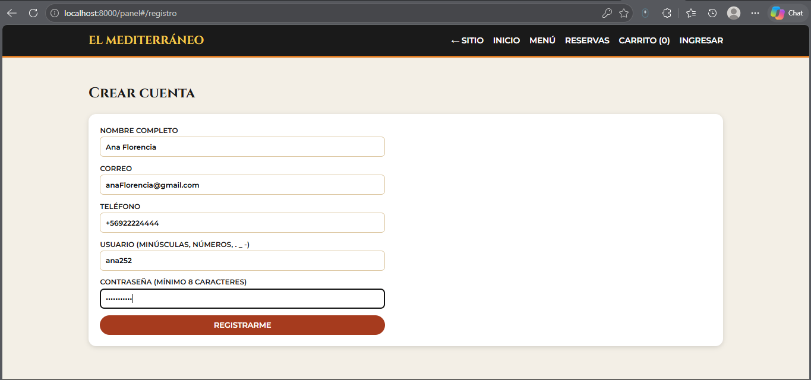 | 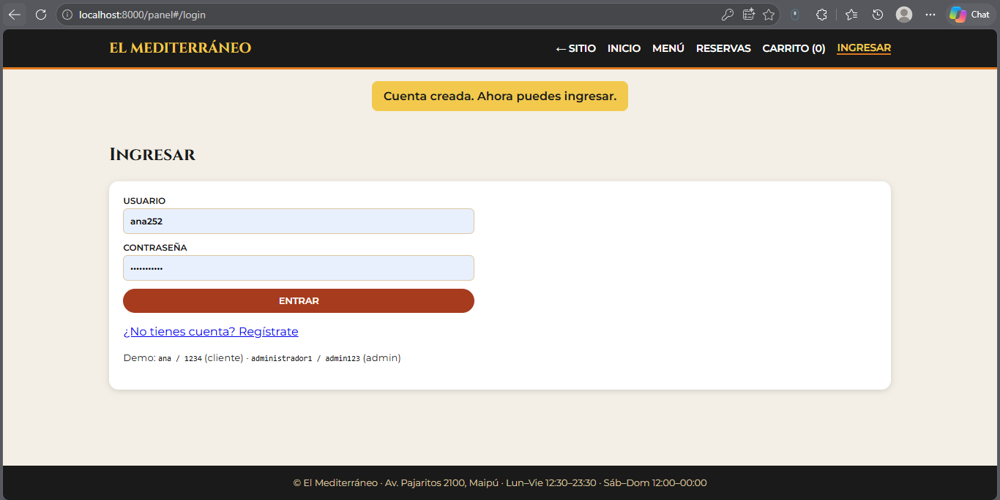 | 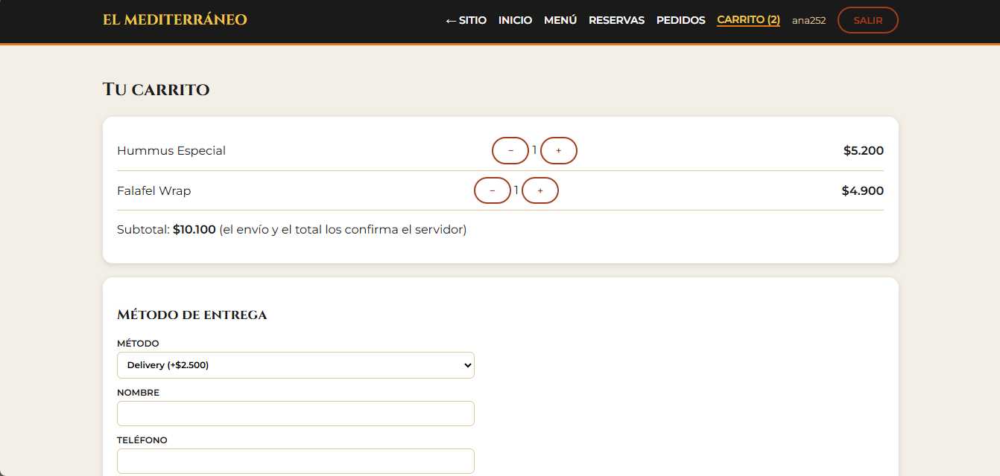 |

| Entrega | Mis pedidos | Móvil |
|---|---|---|
| 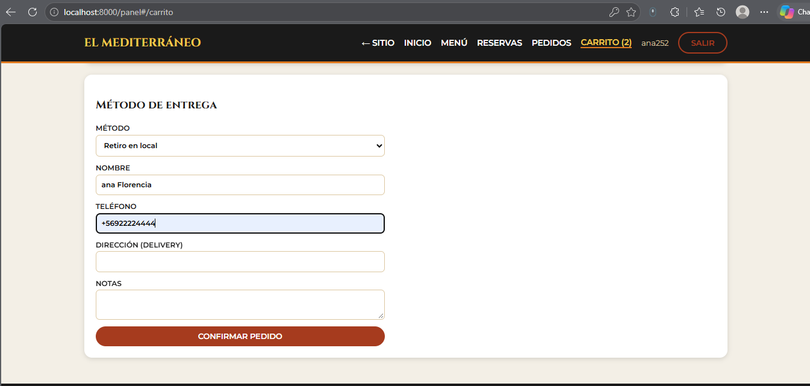 | 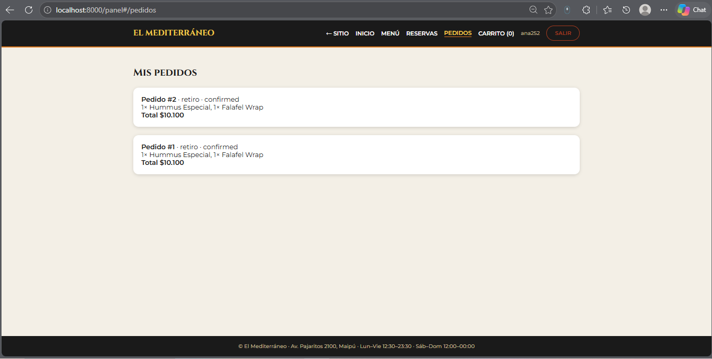 | 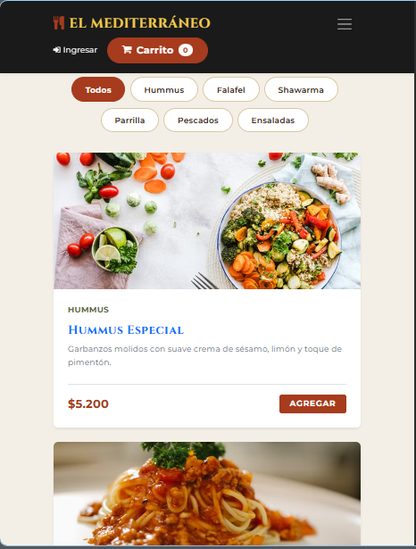 |

---

## 12. Brechas declaradas y limitaciones

Se declaran explícitamente para no afirmar lo que no está implementado ni probado:

| # | Brecha | Estado / mitigación |
|---|---|---|
| 1 | **No hay un gestor de secretos dedicado** (tipo Vault). | El «proveedor de secretos» es `.env` + variables de entorno con secretos aleatorios, fail-fast y sin valores por defecto. En el modelo C4 (`.dsl`) el gestor aparece como contenedor objetivo. |
| 2 | **Sin TLS/mTLS** entre servicios ni en el gateway (HTTP en local). | La cookie tiene `Secure` configurable (`COOKIE_SECURE=true` tras TLS). gRPC usa canal sin cifrar con secreto de servicio, solo en loopback/red interna. En producción se requeriría TLS en el borde y mTLS interno. |
| 3 | **Pasarela de pago simulada**: `payments` aprueba siempre y no recibe webhooks. | Es un adaptador de prueba que conserva el contrato (idempotencia, estados, credencial propia). No hay integración con un proveedor real (Transbank/Stripe). |
| 4 | **Analítica de cocina con valores de demostración** (`GetKitchenMetrics`) y seguimiento (`StreamOrderTracking`) con etapas simuladas. | La telemetría GPS sí se recibe y acota; las métricas no se calculan desde los pedidos reales. Sin pantalla que las consuma. |
| 5 | **gRPC no está expuesto al navegador** ni integrado en GraphQL. | Requeriría un adaptador (SSE/WebSocket) en el gateway. |
| 6 | **Docker Compose no se ejecutó** en el equipo de desarrollo (sin Docker). | Se validó el YAML y se corrigieron comandos y secretos; falta una ejecución real. La entrega reproducible verificada es la de scripts PowerShell. |
| 7 | **Rate limit en memoria** (por proceso e IP). | Suficiente para esta entrega; con varias réplicas debería ser compartido (Redis). |
| 8 | **Sin pantalla de administración para mensajes de contacto ni para cambiar estados de pedidos**: existen los endpoints (S09, S16) y están probados. | Pendiente de interfaz. |
| 9 | Sesiones de 15 minutos sin renovación automática. | El usuario debe volver a ingresar al expirar. |
| 10 | Las pruebas automatizadas simulan la red con transportes ASGI en memoria; la verificación con procesos y puertos reales se hizo de forma manual (tabla de §11). | — |
